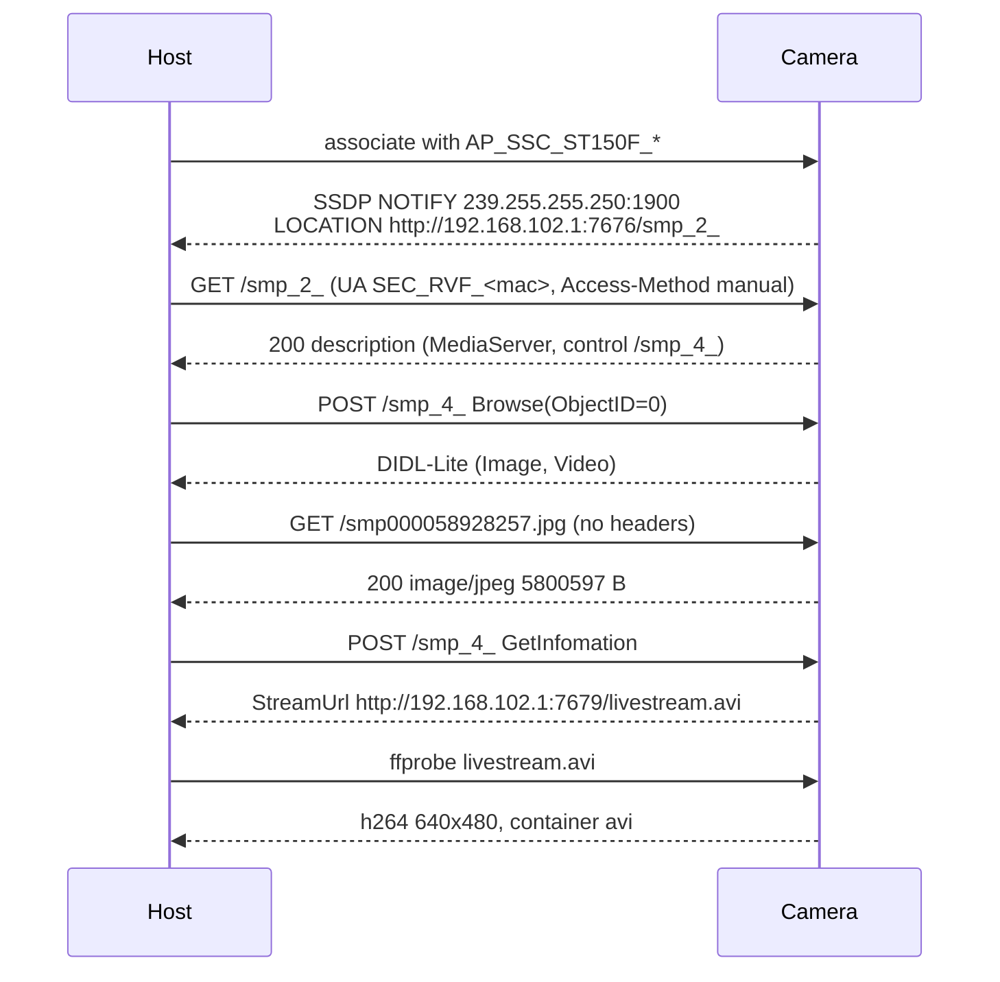

# Samsung Smart Camera — app sources and protocol findings

Decompiled sources of the Samsung Smart Camera app (`com.samsungimaging.connectionmanager`, v1.4.0_180703, versionCode 34) together with a probe harness and two documents that check the app's protocol assumptions against a real **Samsung ST150F** over its own Wi-Fi AP.

The short version: the camera is a DLNA `MediaServer` on `:7676` that announces itself with SSDP `NOTIFY` (it ignores `M-SEARCH`), requires `User-Agent: SEC_RVF_<mac>` + `Access-Method: manual` on the UPnP endpoint, and serves photos and the live stream unauthenticated from `:7679`.

## Layout

| Path | What it is |
|---|---|
| `src/` | Decompiled Java sources, resources and native libraries from the APK. Reference material — it has been reconstructed, not produced from the original project. |
| `build.gradle` | Reconstructed Android build file (compileSdk 26, minSdk 17). Dependencies are not declared, so this does not build as-is. |
| `tools/camera_probe.py` | Stdlib-only probe: mode gate, discovery, description, `Browse`, download, `GetInfomation`, `ffprobe`. |
| `camera-protocol-deep-dive.md` | Static analysis of the protocol, with hardware observations inline as §12 and corrections where the code and the camera disagree. |
| `camera-protocol-hardware-findings.md` | Session report: verdicts, verbatim transcripts, method and tooling (§11), recovery runbook (§11.6). |

## Camera modes

The camera assigns the phone an address whose **third octet encodes the mode**. The camera menu labels are the ones shown by this unit (Portuguese firmware).

| Octet | Camera menu (PT) | App label | Camera-side listeners | Discovery |
|---|---|---|---|---|
| `.101` | Selecione Arquivos no Smartphone | MobileLink / Select Files from Smartphone | `:7679` | none observed |
| `.102` | Remote Viewfinder | Remote Viewfinder | `:7676` (UPnP), `:7679` (files, stream) | SSDP `NOTIFY` |
| `.103` | AutoShare | AutoShare | `:801` | `S2L/1.0` (proprietary) |
| `.104` | Selecione Arquivos na Câmara | MobileLink / Select Files from Camera | `:8100` | `HEAD /sp/control` |

`:7788` (mode control) never opened in any tested mode.

## Remote Viewfinder flow



## Quick start

Host requirements: Linux with `wlan0`, `iproute2`, `iw`, NetworkManager (`nmcli`), `curl`, `ffmpeg`/`ffprobe`, Python 3.9+. No root is needed.

```bash
# camera on, in Remote Viewfinder
python3 tools/camera_probe.py rvf --wait 120 --ssdp-wait 45
# last line is RVF_PASS=ffprobe_ok, or RVF_BLOCKED=reason=...
```

Other subcommands: `ml` (MobileLink, subnet `.101` or `.104` via `--expect-octet`) and `sp` (SelectivePush `/sp/control`). Exit codes: `0` proof captured, `2` wrong camera state, `3` blocked, `4` partial.

## What is verified

| Claim | Status |
|---|---|
| Bare `GET` of a DIDL `<res>` → `200` with real bytes | **verified** — `8239 B` thumbnail, `5,800,597 B` original, `12,403,450 B` MP4 |
| `ffprobe` of `GetInfomation` → `QualityHighUrl` | **verified** — `h264`, `640x480`, `format_name=avi` |
| SSDP discovery via `M-SEARCH` | **false for this unit** — the camera never answers; discovery is multicast `NOTIFY` |
| Description at `/smp_2_`, auth via `User-Agent` + `Access-Method` | **verified** — `200` with `SEC_RVF_<mac>`, `401` otherwise |
| GENA events | **not observed** — `SUBSCRIBE /smp_5_` never answers |
| MobileLink pull path | **untested** — only `:7679` was open there |
| AutoShare `S2L/1.0`, SelectivePush `/sp/control` | **verified** in the corresponding modes |

## Operational notes

- This camera is slow under power save (SYN-ACK 0.02–5.5 s). Keep a `ping -i 0.3` running and use timeouts of 25 s or more.
- **Never scan ports concurrently.** Under load the camera drops every connection, including open ones. The harness probes strictly one connection at a time.
- `:7679` is a single-session server. Killing `ffprobe`/`ffplay` mid-stream leaves it unresponsive for ~20–60 s; it recovers on its own. An unanswered `SUBSCRIBE` wedges it the same way, which is why the harness does not send one.
- If the camera UI also hangs (black viewfinder, lens extended, power button dead), hold power 10–15 s, then remove the battery. Do not push the lens in.

## Provenance

The Java sources were produced by decompiling a shipped APK for interoperability analysis of a camera the author owns. Samsung, Smart Camera and ST150F are trademarks of Samsung Electronics; this repository is not affiliated with or endorsed by Samsung. Review the applicable licence before redistributing the decompiled code or the native libraries in `src/main/lib/`.
