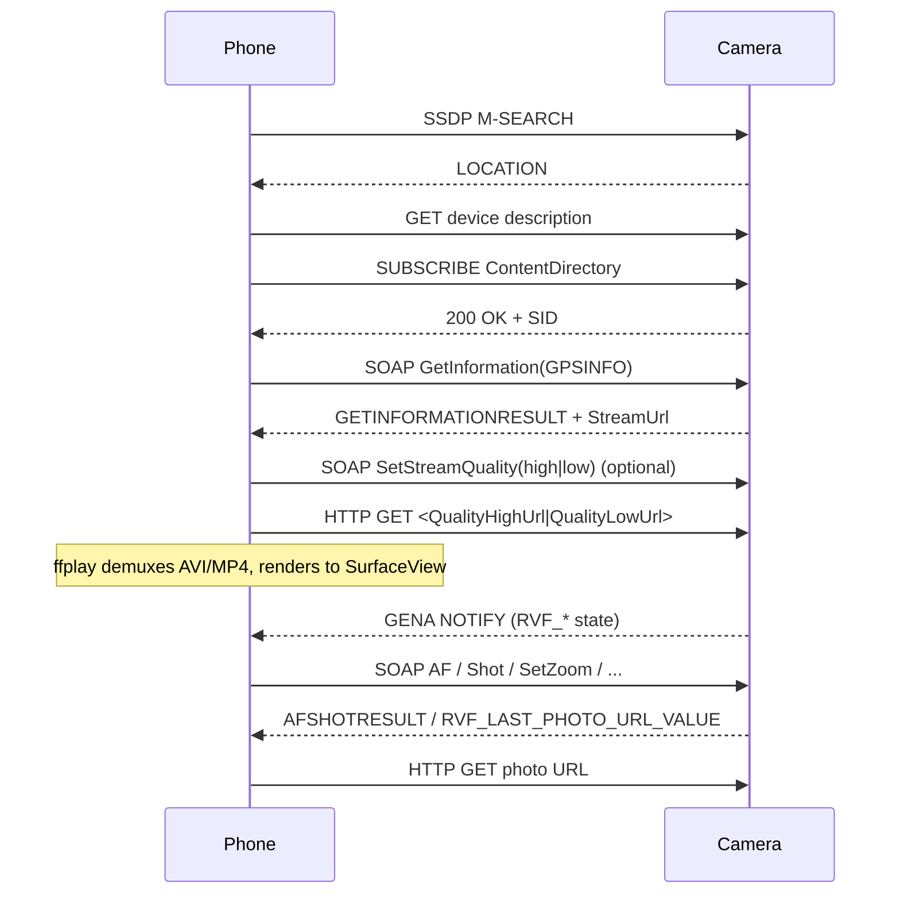

# Samsung Smart Camera connection protocol — deep dive

Static analysis of the decompiled app in this workspace, plus two live sessions against a Samsung ST150F (`AP_SSC_ST150F_0-7D:41:4B`). The camera was exercised in **AutoShare**, **MobileLink** (both sub-options), **SelectivePush** and **Remote Viewfinder**. AutoShare `S2L/1.0`, SelectivePush `/sp/control`, and the Remote Viewfinder UPnP path — discovery, description, `Browse`, bare-`GET` download and the live stream — are hardware-verified end-to-end (§12); the MobileLink pull path remains untested. Claims marked `[INFERENCE]` are derived from code structure, not observed traffic; claims marked `[OBSERVED]` were reproduced against the camera — evidence in §12, standalone report in `camera-protocol-hardware-findings.md`.

Active code paths:

- Connection manager: `com.samsungimaging.connectionmanager.app.cm.*`
- MobileLink (browse/download): `app/pullservice/demo/ml/FileSharing` + `BrowserManager`/`Item`
- Remote viewfinder: `app/pullservice/demo/rvf/LiveShutter` + `DeviceController`
- UPnP stack: `org.cybergarage.*` (CyberGarage)
- Media player: `com.samsungimaging.asphodel.multimedia.FFmpegJNI` + `lib/armeabi-v7a/libffplay-*.so`

The manifest registers both the newer `demo.ml.FileSharing` / `demo.rvf.LiveShutter` activities and older `pullservice.MobileLink` / `RemoteViewFinder` activities (`src/main/AndroidManifest.xml:72-109`). The `com.samsungimaging.filesharing` package is a legacy duplicate and is not referenced by the manifest.

---

## 1. Stack overview

| Layer | Protocol | Who initiates |
|---|---|---|
| Link | Wi-Fi infrastructure/SoftAP, WPA2-PSK or open | Phone joins camera AP |
| Mode negotiation | HTTP `HEAD /mode/control` or HTTP request to phone `ModeServer` | Either direction |
| Discovery | SSDP (UPnP M-SEARCH/NOTIFY) | Phone |
| Description | HTTP GET of SSDP `LOCATION` | Phone |
| Control | SOAP over HTTP POST to the camera’s `ContentDirectory` service | Phone |
| Events | GENA SUBSCRIBE + HTTP NOTIFY | Camera → phone |
| File transfer | Plain HTTP GET of `<res>` URLs | Phone |
| Live view | HTTP progressive AVI/MP4 consumed by FFmpeg | Phone |
| AutoShare push | `S2L/1.0` text protocol over TCP 801: handshake, then camera pushes files to the phone’s TCP 1801 server | Phone handshake, camera pushes `[OBSERVED]` |

No PTP/PTP-IP, RTSP, or Bluetooth transport is used. `S2L/1.0` — a proprietary CRLF header block, not HTTP despite the `Content-Type`/`Content-Length` headers — is the AutoShare ("Shot to Link") transport and was observed on the wire in this session (§12.6). The AutoShare path above was missing from earlier revisions of this document.

---

## 2. Wi-Fi association

### 2.1 AP selection

`CMScanResultReceiver` starts scans every 4 s and filters candidates in `CMUtil.selectCameraSoftAP` (`CMUtil.java:256-315`).

Recognized prefixes:

- Primary: `AP_SSC_`, `GC_`, `EK_`, `SM_` (`CMUtil.java:62-65`)
- Legacy model names: `WB150`, `DV300`, `DV500`, `WB300`, `ST200`, `WB850`, `NX20`, `NX210`, `NX1000`, `EX2`, `MV900`, `QF30` (`CMUtil.java:67-78`)

The SSID is not enough: `isManagedSSID` requires a row in the app’s `DatabaseAP` table (`CMUtil.java:1039-1047`). First-time selection adds it (`SearchAPDialog.java:234`).

### 2.2 Security / credentials

`CMUtil.connectToNewCameraSoftAP` (`CMUtil.java:445-540`):

- Open network → create config, no key.
- Secured network with no saved config → send `NEED_PASSWORD` message; the UI collects the key; then create WEP/WPA/WPA2 config (`CMUtil.java:560-700`).
- Existing config → bump priority and reconnect.
- On Samsung devices, sets the hidden `WifiConfiguration.samsungSpecificFlags` field via reflection, bit 0 (`CMUtil.java:483-498`, `:620-645`).

`WifiManager.enableNetwork(id, true)` + `reconnect()` is the actual association.

### 2.3 Camera address

Camera IP = `DhcpInfo.serverAddress`; phone IP = `DhcpInfo.ipAddress` (`ModeClient.java:57-63`, `CMUtil.java:878-885`).

### 2.4 NFC bootstrap

The manifest accepts `android.nfc.action.NDEF_DISCOVERED` with MIME type `application/com.samsungimaging.connectionmanager` (`AndroidManifest.xml:52-64`).

`Main.processTag` reads the first NDEF record payload, trims/uppercases it, and treats it as the camera SSID (`Main.java:640-670`). NFC carries no session protocol; it only adds the AP and starts the same Wi-Fi flow.

### 2.5 Mode encoded in the camera IP

For Galaxy-series cameras, `getAppTypeFromCamera` parses the third octet of the camera IP (`CMUtil.java:855-885`):

| Third octet | `appType` | Service |
|---|---|---|
| 101 | 1 | MobileLink |
| 102 | 2 | Remote ViewFinder |
| 103 | 3 | AutoShare |
| 104 | 4 | SelectivePush |
| 107 | 8 | Legacy mode-manager |

`CMService.checkSubApplicationType` auto-launches the mapped activity (`CMService.java:429-472`). Anything else falls through to the mode-manager dialog.

`[INFERENCE]` (scope) The mapping is not Galaxy-only: it was confirmed on a non-Galaxy ST150F whose AP served `192.168.103.1` — octet `103` — and which answered only the AutoShare `S2L/1.0` service on TCP 801 (§12.6).

`[OBSERVED]` The corresponding subnets are `192.168.101.x` … `192.168.107.x`, consistent with the test URL `http://192.168.101.1:7679/...` in `MobileLink.java:84`. Observed: DHCP on the camera AP handed out `192.168.103.11/24` with gateway/server `192.168.103.1` (§12.1).

---

## 3. Mode negotiation

Two independent channels exist. The app may run both.

### 3.1 Phone → camera (`ModeClient`)

`ModeClient.run` (`ModeClient.java:52-90`):

```
TCP connect: <camera IP>:7788, 3 s timeout
Send:
  HEAD /mode/control HTTP/1.1
  User-Agent: SEC_MODE_<phone number or uppercase MAC>
  Connection: Close
  NTS : alive
  Content-Length: 0
  HOST-Mac : <wifi MAC lowercase>
  HOST-Address : <phone IP>
  HOST-port : 7788
  HOST-PNumber : <phone number>
  Access-Method : manual
  CALLBACK: <http://<phone IP>:7789/eventCallback>
```

- Up to 16 attempts (`CMConstants.MODECLIENT_MAX_TRY_COUNT`).
- `ConnectException` sleeps 500 ms and retries.
- Reads until the first `\n`; accumulates the response string.
- `checkResponse` (`ModeClient.java:366-410`):
  - `HTTP/1.1 200 OK` → parse `Default-URL:` and mode strings.
  - Contains `<currentmode>mobilelink</currentmode>` → 1; `rvf` → 2; `autoshare` → 3; `selectivepush` → 4; `groupshare` → 5; `mobilebackup` → 6; `idle` → 7; `byebye` → 23.
  - Contains `MVERSION` → `CMInfo.setIsOldCamera(false)`.
  - `HTTP/1.1 401` → 21; `HTTP/1.1 503` → 22.

`Default-URL` parsing (`CMUtil.java:996-1010`) scans each line for `Default-URL:` and returns the first substring containing `http`. The value is stored in `CMInfo` and passed as `default_url_for_ml_rvf` to the activity (`CMService.java:488-501`), but grep finds no reader in the ML/RVF code. `[INFERENCE]` It is legacy/unused in this build.

`[OBSERVED]` `:7788` is **not** open while the camera is in AutoShare mode: the exact request above gets no TCP handshake at all (SYN dropped; `curl` exit 28 after 8 s, no `200`/`401`/`503`), so none of the `checkResponse` branches can fire. `:7788` was also closed in MobileLink and Remote Viewfinder (§12.7a).

### 3.2 Camera → phone (`ModeServer`)

`ModeServer` binds to the phone’s Wi-Fi IP (not `0.0.0.0`) on TCP **7789** (`ModeServer.java:38-45`). After each accepted connection it closes the socket, increments the port, and wraps at 7794 back to 7789 (`ModeServer.java:60-85`).

`ModeServerResponse.checkRequest` (`ModeServerResponse.java:274-304`):

- Requires `samsung mode server` (case-insensitive) and a `<currentmode>...</currentmode>` string.
- Same mode codes as above.
- Replies `HTTP/1.1 200 OK` with `Content-Length: 0`.
- Then calls `performRunSubApplication(mode)` or `performRunByebye()`.

If a sub-application is already alive, a different mode request waits up to 6 × 500 ms for it to exit before starting the new one (`ModeServerResponse.java:104-130`).

`[OBSERVED]` With `7789`–`7793` bound on the probe host, no camera-initiated connection arrived in a 115 s window while the camera sat in AutoShare mode (§12.3). The camera→phone direction therefore requires a mode action on the camera itself.

### 3.3 Mode codes

`CMConstants.MsgId` / `CMConstants.MsgString` (`CMConstants.java:70-105`):

| Code | Intent | String |
|---|---|---|
| 1 | MobileLink | `mobilelink` |
| 2 | Remote ViewFinder | `rvf` |
| 3 | AutoShare | `autoshare` |
| 4 | SelectivePush | `selectivepush` |
| 5 | GroupShare | `groupshare` |
| 6 | MobileBackup | `mobilebackup` |
| 7 | Idle | `idle` |
| 23 | Byebye | `byebye` |

### 3.4 Old/new camera fork

`CMUtil.checkOldVersionSmartCameraApp` (`CMUtil.java:107-125`):

- Starts `true` (old).
- Only for SSIDs containing `AP_SSC_`: splits the SSID and checks the model token against `NX MINI`, `NX3000`, `NX3300`; if matched, old=false.
- If `CMInfo.isOldCamera()` was set false by an `MVERSION` response, old=false.

Effects in `PullService` (`PullService.java:190-215`):

| Case | SSDP port | User-Agent prefix |
|---|---|---|
| Old MobileLink (`ACTIVE_SERVICE == 1`) | 1901 | `SEC_DSC_` |
| Old RVF (`ACTIVE_SERVICE == 2`) | 1900 | `SEC_RVF_` |
| New MobileLink/RVF | 1900 | `SEC_RVF_ML_` |

For old cameras, `Access-Method` is `nfc` when launched by NFC, otherwise `manual`. For new cameras the code hardcodes `manual` (`PullService.java:196-212`).

---

## 4. UPnP discovery and description

### 4.1 SSDP

`ControlPoint.start` (`ControlPoint.java:618-660`) opens:

- A local HTTP server for GENA events, default port **8059**, URI `/evetSub` (`ControlPoint.java:38-39,96`).
- SSDP notify and search-response sockets on port **1900** (or 1901).
- Sends the initial search, then `MSearchStart` repeats `search()` every 1 s until a device is found (`UPNPController.java:190-215`).

Search request (`SSDPSearchRequest.java`):

```
M-SEARCH * HTTP/1.1
HOST: 239.255.255.250:1900
MAN: "ssdp:discover"
MX: 3
ST: ssdp:all
```

Port is `SSDP.PORT`, default 1900 (`SSDP.java:8`).

### 4.2 Description fetch

When an SSDP response has a `LOCATION`, `ControlPoint.addDevice` fetches it with the parser (`ControlPoint.java:155-185`). `Parser.parse` adds (`Parser.java:20-35`):

```
User-Agent: <userAgent>
Access-Method: <accessMethod>
```

Where `userAgent` is assembled by `Utils.getAgent` as prefix + phone number, else Wi-Fi MAC, else `UNKNOWN` (`pullservice/util/Utils.java:25-49`), and `accessMethod` is `manual` or `nfc`.

The app then looks for a device whose `deviceType` contains `MediaServer`, and a service whose `serviceType` contains `ContentDirectory` (`UPNPController.java:150-175`). It subscribes to that service:

```
SUBSCRIBE <eventSubURL> HTTP/1.1
Host: <camera>:<port>
CALLBACK: <http://<phone IP>:8059/evetSub>
NT: upnp:event
TIMEOUT: Second-<n>
```

(`SubscriptionRequest.java:55-75`).

### 4.3 SOAP format

CyberGarage builds the envelope in `SOAP.createEnvelopeBodyNode` and `ActionRequest.createContentNode` (`SOAP.java:33-42`, `ActionRequest.java:56-90`):

```xml
<?xml version="1.0" encoding="utf-8"?>
<s:Envelope xmlns:s="http://schemas.xmlsoap.org/soap/envelope/"
            s:encodingStyle="http://schemas.xmlsoap.org/soap/encoding/">
  <s:Body>
    <u:ActionName xmlns:u="<serviceType from SCPD>">
      <ArgName>value</ArgName>
    </u:ActionName>
  </s:Body>
</s:Envelope>
```

HTTP headers:

```
POST <controlURL> HTTP/1.1
Host: <camera>:<port>
Content-Type: text/xml; charset="utf-8"
SOAPACTION: "<serviceType>#ActionName"
Content-Length: <n>
```

`ActionRequest.java:62-65` sets the `SOAPACTION` value exactly as `"<serviceType>#<actionName>"`.

The app does not hardcode the service URN; it uses whatever the camera’s SCPD advertises. In the examples below `<serviceType>` is a placeholder, commonly `urn:schemas-upnp-org:service:ContentDirectory:1`.

---

## 5. Browsing

### 5.1 Request

`Item.browse` (`Item.java:452-478`):

```xml
<u:Browse xmlns:u="<serviceType>">
  <ObjectID>0</ObjectID>
  <BrowseFlag>BrowseDirectChildren</BrowseFlag>
  <Filter>*</Filter>
  <StartingIndex>0</StartingIndex>
  <RequestedCount>100</RequestedCount>
  <SortCriteria></SortCriteria>
</u:Browse>
```

Outputs used: `NumberReturned` and `Result` (`Item.java:477-486`).

- Root `ObjectID` is always reset to `"0"` (`BrowseManager.java:38`).
- `StartingIndex` advances by the number returned.
- Page size 100; overall cap ~1000 items (`BrowseManager.java:26-75`).
- `Filter` is `*`, so the camera returns all metadata and all `<res>` variants.

### 5.2 DIDL-Lite parsing

`Item.addItem` (`Item.java:300-450`) walks the parsed XML:

- Element name `container` → `Container`; `item` → file item.
- Attributes: `id`.
- Child elements read: `dc:title`, `upnp:album`, `dc:date`, `upnp:class`.
- `<res>` children: `protocolInfo`, `size`, `resolution`, and the URL as text.

`protocolInfo` mapping (`Item.java:350-430`):

| Contains | Field | Use |
|---|---|---|
| `JPEG_TN` | `thumbRes` | grid thumbnail |
| `JPEG_LRG` | `res` | full-size original |
| `JPEG_MED` | fallback `res` / preview | medium image |
| `JPEG_SM` | `screenRes` or fallback thumb | small preview |
| `video/mp4` | `res` + `resolution` | video original |
| anything else | `res` | generic original |

If `size` is null/empty/zero, the item is counted but not added (`Item.java:432-441`). Containers go into the parent’s list; files go into the global `FileSharing.mContainerList`.

The UI groups files by `dc:date` through the app’s media database, not by the camera’s container hierarchy (`MobileLink.java:150-180`).

---

## 6. Downloading

### 6.1 Full files

`CustomDialogFileSave.saveFile` (`CustomDialogFileSave.java:289-340`):

```java
URL url = new URL(item.getRes());
URLConnection con = url.openConnection();
con.setReadTimeout(5000);
con.connect();
InputStream in = con.getInputStream();
// stream to file in 4 KB chunks
```

- No custom headers, no auth token.
- Save root: `/sdcard/DCIM/Camera/Samsung Smart Camera Application/MobileLink/` (`demo/ml/Utils.java:71-75`).
- Filename: `item.getTitle()`; if it has no extension, append the extension from the URL path. Duplicates become `name-0.ext`, `name-1.ext`, … (`CustomDialogFileSave.java:342-365`, `FileManager.renameFile`).
- After writing: `MediaScannerConnection.scanFile` and `ExifInterface` read (`CustomDialogFileSave.java:326-340`).
- Free-space check uses `item.getSize()` vs available external storage (`CustomDialogFileSave.java:93-105`).

### 6.2 Thumbnails

`ImageLoader` (`ImageLoader.java:60-140`):

- Cache key: `String.valueOf(url.hashCode())` under `.../MobileLink/LazyList`.
- Normal path: `new URL(url).openStream()`; for API > 13 sets `Connection: close`.
- QF30 path: raw socket `HumbleHttpClient`, writes `GET <path> HTTP/1.0` and parses headers manually (`HumbleHttpClient.java:29-70`).

### 6.3 Copy flow

1. `GetDeviceConfiguration` → reads `TranferOption` (sic) → sets resize mode (`DeviceController.java:1459-1470`).
2. Browse all containers.
3. User selects files.
4. `SetTotalCopyItems(TotalNumber)` (`FileSharing.java:960-980`).
5. On success, `CustomDialogFileSave` downloads each selected item (`FileSharing.java:140-145,1489-1500`).

### 6.4 Security

All control and transfer requests are unauthenticated. The camera relies on the Wi-Fi association (and possibly AP client isolation) for access control. Do not treat the camera AP as a trusted network.

---

## 7. Remote viewfinder

### 7.1 Sequence



### 7.2 `GetInformation`

`DeviceController.getInformateionAct` (`DeviceController.java:867-875`):

```xml
<u:GetInformation xmlns:u="<serviceType>">
  <GPSINFO>...</GPSINFO>
</u:GetInformation>
```

The response body is parsed by `resetCamera` (`DeviceController.java:1486-1990`). It expects sibling nodes under the action response:

- `GETINFORMATIONRESULT` — capability/state tree.
- `StreamUrl` — child elements whose names/values become `DSCMenuItem`s (`DeviceController.java:1948-1972`).
- `GETIPRESULT` — older single-URL alternative (`DeviceController.java:1974-1982`).

`GETINFORMATIONRESULT` fields parsed:

| Field | Contents |
|---|---|
| `Version` | `prefix_version` or version |
| `DialModeValue` | supported modes + default |
| `Resolutions` | width/height/ratio list, default, disabled entries |
| `Flash` / `FlashDisplay` | supported flash modes, default, current |
| `DefaultFocusState` | `mf`/`af` etc. |
| `ZoomInfo` | default/max/min zoom |
| `AutoFocus` | `AFPriority` |
| `AVAILSHOTS` | remaining shots |
| `RemainRecTime` | remaining movie seconds |
| `StreamQuality` | `Quality` list + default (`high`/`low`) |
| `ROTATION` | current orientation |
| `EVValue`, `ISOValue`, `WBValue`, `MeteringValue` | supported list + default |
| `AFModeValue`, `AFAreaValue`, `DriveValue` | supported list + default |
| `ShutterSpeedValue`, `ApertureValue` | supported list + default |
| `QualityValue` | supported list + default |
| `MovieResolutionValue` | supported resolutions/ratios + default |
| `MultiAFMatrixSize` | AF grid |
| `FileSaveValue` | camera/phone/all save options |
| `RatioOffset` | ratio-specific offsets |
| `TouchAF` | supported modes + default + disabled |
| `VideoOutValue`, `FlashStrobeStatus`, `CardStatusValue` | status |

`StreamUrl` children used:

- `QualityHighUrl` / `QualityLowUrl` for still live view (`DeviceController.java:1948-1972`).
- `QualityHighMjpgUrl` / `QualityLowMjpgUrl` for movie-mode streaming (`DeviceController.java:1192-1212`).
- `GETIPRESULT` for older firmware (`DeviceController.java:1974-1982`).

Default stream quality is `"high"` (`DSCCamera.java:44`). `GetInformation` updates it from the `StreamQuality` default.

### 7.3 `SetStreamQuality`

`DeviceController.java:1169-1190`:

```xml
<u:SetStreamQuality xmlns:u="<serviceType>">
  <Quality>high</Quality>
</u:SetStreamQuality>
```

On success it selects the matching URL from the `StreamUrl` menu. Movie mode uses the same action with `QualityHighMjpgUrl`/`QualityLowMjpgUrl`.

### 7.4 Playback

`LiveShutter.codec_start` (`LiveShutter.java:8184-8230`) builds the FFmpeg command line:

```
ffplay -livestreaming -pktqimmediateflush -pictqinitialemptysec 4
  -demuxprobesize 512 -an -sync ext -framedrop -infbuf
  -pictqsize 15 -displayresolution <W>x<H>
  -f avi|mp4 <streamURL>
```

- Container selection: URL contains `.avi`/`.AVI` → `-f avi`; `.mp4`/`.MP4` → `-f mp4`; otherwise AVI.
- `-an` disables audio.
- `FFmpegJNI.request(VIDEO_STREAMING_START, cmd)` spawns `ffplayMain` on a native thread (`FFmpegJNI.java:150-175`).
- Frames are decoded into `FFmpegPicture` and drawn to the `SurfaceView` through `FFmpegScreen`.
- `codec_start` waits up to 5 s for `FFmpegJNI.mConnectResponse`; otherwise it unsubscribes/closes (`LiveShutter.java:8201-8225`).
- Invocation path: `surfaceCreated`/`surfaceChanged` → `GetLiveStream()` → handler flag 48 → `InitCodecTask` → `codec_start()` (`LiveShutter.java:3025-3027`, `:6737-6740`, `:7226-7238`).

The native library is FFmpeg 2.1 with decoders `h264`, `hevc`, `mpeg4`, `mjpeg`, `mpeg2video`, etc., and demuxers for AVI/MP4 (`strings libffplay-jni.so`). The app only uses HTTP URLs. `[INFERENCE]` The actual codec can be MJPEG-in-AVI or H.264-in-MP4 depending on camera model/firmware; the app does not inspect the codec, only the container.

The legacy `RemoteViewFinder` activity uses the same URL and a slightly different flag set (`RemoteViewFinder.java:447-450`).

### 7.5 Camera control actions

`DeviceController.setAction` binds these action names from the `ContentDirectory` service (`DeviceController.java:340-392`). All are sent as SOAP actions on that same service.

| Action | Input arguments | Notes |
|---|---|---|
| `GetInformation` | `GPSINFO` | Returns capabilities + stream URLs |
| `GetDeviceConfiguration` | — | `TranferOption` → resize mode |
| `GetZoom` | — | |
| `SetZoom` | `ZOOMLEVEL` | |
| `StartZoom` / `StopZoom` | `ZoomDirection` | |
| `ZoomIN` / `ZoomOUT` | — | |
| `AF` | — | single AF |
| `MULTIAF` | — | multi AF |
| `touchAF` | `AFPOSITION` | |
| `touchAFPoint` | `AFPOSITION` | |
| `touchAFMovie` | `AFPOSITION` | |
| `CancelTouchAFMovie` | `MovieTouchAFStatus` | |
| `setTouchAFOption` | `TOUCH_AF_OPTION` | |
| `ReleaseSelfTimer` | `RELEASETIMER` | |
| `Shot` | `REQUESTIMAGE` | Outputs `AFSHOTRESULT`, `AVAILSHOTS`, `CurrentFlashDisplay`, `RemainRecTime` |
| `ShotWithGPS` | — | |
| `ShutterUp` | — | |
| `StartShot` / `StopShot` | `DriveValue` | |
| `StartRecord` / `StopRecord` | — | Output `RemainRecTime`, `AVAILSHOTS` |
| `SetStreamQuality` | `Quality` | `high` / `low` |
| `SetResolution` | `RESOLUTION` | Output `AVAILSHOTS`, `ResolutionRatio` |
| `SetFlash` | `FLASHMODE` | |
| `SetLED` | `LEDTIME` | |
| `SetShutterSpeed` | `ShutterSpeedValue` | |
| `SetAperture` | `ApertureValue` | |
| `SetEV` | `EVValue` | |
| `SetISO` | `ISOValue` | |
| `SetWB` | `WBValue` | |
| `SetMetering` | `MeteringValue` | |
| `SetAFMode` | `AFModeValue` | |
| `SetAFArea` | `AFAreaValue` | |
| `SetDrive` | `DriveValue` | |
| `SetDialMode` | `DialModeValue` | |
| `SetQuality` | `QualityValue` | |
| `SetMovieResolution` | `MovieResolutionValue` | |
| `SetFileSave` | `FileSaveValue` | |
| `SetOperationState` | `StateEvent` | `changeToML` / `changeToRVF` |
| `SetTotalCopyItems` | `TotalNumber` | |

Actions are queued through `CommandManager` and executed serially (`DeviceController.java:721-733`, `:1992-1996`).

### 7.6 Events

`UPNPController.eventNotifyReceived` maps GENA state variables (`UPNPController.java:70-135`):

| Event variable | Meaning |
|---|---|
| `RVF_ROTATION_STATUS` | live-view rotation |
| `RVF_FLASH_STATUS` | flash mode |
| `RVF_FOCUS_STATUS` | focus state |
| `RVF_SHUTTER_SPEED_SETUP_VALUE` | shutter speed |
| `RVF_APERTURE_SETUP_VALUE` | aperture |
| `RVF_EV_SETUP_VALUE` | exposure compensation |
| `RVF_REMAIN_SHOT_COUNT_VALUE` | remaining shots |
| `RVF_LAST_PHOTO_URL_VALUE` | URL of the just-captured photo |
| `RVF_CURRENT_ZOOM_VALUE` | current zoom |
| `RVF_APERTURE_LIST` | aperture list |
| `RVF_SHUTTER_SPEED_LIST` | shutter-speed list |
| `RVF_MOVIE_RECORD_TIME` | recording elapsed time |
| `RVF_REMAIN_REC_TIME_VALUE` | remaining record time |
| `RVF_FLASH_STROBE_STATUS` | flash strobe state |
| `OperationState` | `TransitionToRVF` / `TransitionToML` |

Unknown variables are delivered as message 20.

### 7.7 Photo save after a shot

- `Shot` response contains `AFSHOTRESULT` → stored as the shot URL (`DeviceController.java:1069-1095`).
- Or the camera pushes `RVF_LAST_PHOTO_URL_VALUE` (`LiveShutter.java:2061-2067`).
- If save-on-phone is enabled, `ImageDownloader.downloadImage(url)` fetches the URL with plain HTTP GET (`ImageDownloader.java:30-46`, `:86-130`).
- Save root: `/sdcard/DCIM/Camera/Samsung Smart Camera Application/RemoteViewfinder/` (`FileManager.java:13-18`).
- Then `MediaScannerConnection` and a thumbnail are generated.

### 7.8 ML ↔ RVF switch

- Request: `SetOperationState` with `StateEvent=changeToRVF` or `changeToML`.
- Confirmation: camera event `OperationState` with `TransitionToRVF` or `TransitionToML`.
- `FileSharing` reacts by starting `LiveShutter`; `LiveShutter` reacts by starting `FileSharing` (`FileSharing.java:110-125`, `LiveShutter.java:6819-6824`).

### 7.9 Rotation

`RVF_ROTATION_STATUS` values are strings such as `ssdp:rotationL`, `ssdp:rotationR`, `ssdp:rotationU`, `ssdp:rotationD`. The UI maps them to 0/90/180/270 and calls `FFmpegJNI.request(SCREEN_CONFIG_CHANGE, ...)` (`LiveShutter.java:6505-6523`).

---

## 8. Minimal probe recipe

Prerequisites: phone/laptop joined to the camera AP; camera IP obtained from DHCP (usually the gateway).

### 8.1 Mode query

```bash
CAM=192.168.107.1
PHONE=$(ip -4 addr show wlan0 | awk '/inet /{print $2}' | cut -d/ -f1)

curl -i --max-time 5 -X HEAD "http://$CAM:7788/mode/control" \
  -H "User-Agent: SEC_MODE_$(echo $PHONE | tr -d .)" \
  -H "Connection: Close" \
  -H "NTS : alive" \
  -H "Content-Length: 0" \
  -H "HOST-Mac : 00:00:00:00:00:00" \
  -H "HOST-Address : $PHONE" \
  -H "HOST-port : 7788" \
  -H "HOST-PNumber : none" \
  -H "Access-Method : manual" \
  -H "CALLBACK: <http://$PHONE:7789/eventCallback>"
```

Expected: `HTTP/1.1 200 OK` plus `<currentmode>...` and possibly `Default-URL:`/`MVERSION`.

### 8.2 SSDP

```bash
python3 - <<'PY'
import socket
msg = ("M-SEARCH * HTTP/1.1\r\n"
       "HOST: 239.255.255.250:1900\r\n"
       'MAN: "ssdp:discover"\r\n'
       "MX: 3\r\n"
       "ST: ssdp:all\r\n\r\n")
s = socket.socket(socket.AF_INET, socket.SOCK_DGRAM, socket.IPPROTO_UDP)
s.settimeout(4)
s.sendto(msg.encode(), ("239.255.255.250", 1900))
while True:
    try:
        data, addr = s.recvfrom(4096)
        print(addr, data.decode(errors="replace"))
    except socket.timeout:
        break
PY
```

Look for `LOCATION: http://<camera>:<port>/...xml`.

### 8.3 Description and service

```bash
curl -s "http://$CAM:<port>/<description.xml>" \
  -H "User-Agent: SEC_RVF_ML_<phone-or-mac>" \
  -H "Access-Method: manual"
```

Find `<serviceType>` containing `ContentDirectory`, its `<controlURL>`, and `<eventSubURL>`.

### 8.4 Browse

```bash
curl -i "http://$CAM:<port><controlURL>" \
  -H 'Content-Type: text/xml; charset="utf-8"' \
  -H 'SOAPACTION: "<serviceType>#Browse"' \
  --data-binary @- <<'XML'
<?xml version="1.0" encoding="utf-8"?>
<s:Envelope xmlns:s="http://schemas.xmlsoap.org/soap/envelope/"
            s:encodingStyle="http://schemas.xmlsoap.org/soap/encoding/">
  <s:Body>
    <u:Browse xmlns:u="<serviceType>">
      <ObjectID>0</ObjectID>
      <BrowseFlag>BrowseDirectChildren</BrowseFlag>
      <Filter>*</Filter>
      <StartingIndex>0</StartingIndex>
      <RequestedCount>100</RequestedCount>
      <SortCriteria></SortCriteria>
    </u:Browse>
  </s:Body>
</s:Envelope>
XML
```

Parse the escaped DIDL-Lite `Result`; extract `<res protocolInfo=... size=...>URL</res>`.

### 8.5 Live view

```bash
curl -i "http://$CAM:<port><controlURL>" \
  -H 'Content-Type: text/xml; charset="utf-8"' \
  -H 'SOAPACTION: "<serviceType>#GetInformation"' \
  --data-binary @- <<'XML'
<?xml version="1.0" encoding="utf-8"?>
<s:Envelope xmlns:s="http://schemas.xmlsoap.org/soap/envelope/"
            s:encodingStyle="http://schemas.xmlsoap.org/soap/encoding/">
  <s:Body>
    <u:GetInformation xmlns:u="<serviceType>">
      <GPSINFO></GPSINFO>
    </u:GetInformation>
  </s:Body>
</s:Envelope>
XML
```

Extract `StreamUrl/QualityHighUrl` (or `QualityLowUrl`), then:

```bash
ffplay -f avi -an "http://<camera>:<port>/<stream>.avi"
# or -f mp4 for .mp4
```

---

## 9. Old vs new behavior matrix

| Aspect | Old path | New path |
|---|---|---|
| Trigger | Camera IP `.107` or managed AP dialog | Camera IP `.101`–`.104` for Galaxy series |
| Mode query | `HEAD /mode/control` to `:7788` and/or camera → phone `:7789` | Same, but auto-launch often bypasses it |
| SSDP port ML | 1901 | 1900 |
| SSDP port RVF | 1900 | 1900 |
| UA prefix ML | `SEC_DSC_` | `SEC_RVF_ML_` |
| UA prefix RVF | `SEC_RVF_` | `SEC_RVF_ML_` |
| Access-Method | `nfc` or `manual` | always `manual` in code |
| `MVERSION` | absent | present in mode response |

---

## 10. Quirks, failure modes, and things not used

### 10.1 Timeouts and retries

- Mode client: 3 s connect timeout, 16 attempts, 500 ms backoff on connect exception (`ModeClient.java:52-130`).
- PullService UI timeout: 180 s (`PullService.java:192`).
- Browse/download: `CustomDialogFileSave` sets a 5 s read timeout (`CustomDialogFileSave.java:300`).
- RVF stream connect: 5 s wait for `mConnectResponse` (`LiveShutter.java:8201-8225`).
- Event subscription renewal: CyberGarage `RenewSubscriber` runs in NMPR mode (`ControlPoint.java:650-660`).

### 10.2 Port conflicts

- Event HTTP server: starts at 8059; if bind fails, increments up to 100 times (`ControlPoint.java:626-640`).
- SSDP: starts at 1900/1901; increments on bind failure (`ControlPoint.java:642-652`).
- ModeServer: 7789–7793, persisted in `SharedPreferences` (`ModeServer.java:60-85`, `Main.java:418-421`).

### 10.3 Known code quirks

- `ImageDownloader.java:123-126` reads from `bin` before assigning it in the decompiled source. The real APK likely assigned `bin = new BufferedInputStream(in)`; do not reuse the decompiled function as-is.
- `Default-URL` is parsed and passed but never read by the active ML/RVF activities.
- `ModeClient` sends `HOST-port: 7788` even though the phone’s actual ModeServer port may be 7789+; the `CALLBACK` header carries the real port.
- `ModeServer` binds to the phone’s Wi-Fi IP, not all interfaces.
- `UPNPController.connect` calls `MSearchStart` before `SSDP.setSSDPPort`, so the first search can race the port change (`UPNPController.java:55-58`).
- The legacy `com.samsungimaging.filesharing` package duplicates the same SSDP/SOAP/HTTP approach but is unreferenced by the manifest.

### 10.4 Not used

- PTP / PTP-IP: no code or strings.
- RTSP: the FFmpeg build supports it, but the app passes HTTP URLs to `ffplay`.
- Bluetooth: no code.
- Any authentication/token exchange for SOAP or HTTP transfers.

---

## 11. Evidence map

| Claim | Primary source |
|---|---|
| Wi-Fi prefixes / old models | `CMUtil.java:62-78` |
| SoftAP connect / password / Samsung flag | `CMUtil.java:445-700` |
| Mode from IP octet | `CMUtil.java:855-885` |
| Mode client request | `ModeClient.java:52-90` |
| Mode response parsing | `ModeClient.java:366-410` |
| Mode server | `ModeServer.java:38-85`, `ModeServerResponse.java:274-304` |
| Mode codes | `CMConstants.java:70-105` |
| Old/new fork and SSDP ports/UAs | `CMUtil.java:107-125`, `PullService.java:190-215` |
| SSDP search | `ControlPoint.java:390-410,618-660`, `SSDPSearchRequest.java` |
| Event server / callback URI | `ControlPoint.java:38-39,96` |
| Description headers | `Parser.java:20-35`, `pullservice/util/Utils.java:25-49` |
| MediaServer/ContentDirectory selection | `UPNPController.java:150-175` |
| SOAP envelope/action header | `SOAP.java:33-42`, `ActionRequest.java:56-90` |
| Browse arguments | `Item.java:452-478` |
| DIDL res mapping | `Item.java:350-450` |
| Download path/naming | `CustomDialogFileSave.java:289-365`, `demo/ml/Utils.java:71-75` |
| Thumbnail fetch/cache | `ImageLoader.java:60-140` |
| GetInformation / StreamUrl | `DeviceController.java:867-875,1486-1990` |
| SetStreamQuality | `DeviceController.java:1169-1212` |
| FFmpeg command | `LiveShutter.java:8184-8230` |
| FFmpeg JNI | `FFmpegJNI.java:150-175` |
| Control action names | `DeviceController.java:110-215,340-392` |
| Events | `UPNPController.java:70-135` |
| Shot URL / download | `DeviceController.java:1069-1095`, `LiveShutter.java:2061-2067` |
| ML/RVF switch | `FileSharing.java:110-125`, `LiveShutter.java:6819-6824` |
| Rotation mapping | `LiveShutter.java:6505-6523` |
| NFC SSID payload | `Main.java:640-670` |
| AutoShare `S2L/1.0` transport + handshake/reply strings | `AutoShare.java:457-459,1170-1215,1358-1395`, `AutoShare.java:76` + §12.6 |
| Octet `103` = AutoShare (non-Galaxy ST150F) | `CMUtil.java:855-885` + §12.1 |
| Mode channels dead in AutoShare mode | §12.3 |

---

## 12. Hardware observations

Live session 2026-10-17 16:48–17:1x WEST against one Samsung **ST150F** running **AutoShare**. The camera was not touched: no mode was selected on its UI, no photo was taken. That single constraint is what limited the session to AutoShare — see §12.3.

### 12.1 Environment (step 1)

| Item | Observed value |
|---|---|
| Model | ST150F (from SSID `AP_SSC_ST150F_0-7D:41:4B`) |
| Camera MAC / AP BSSID | `a0:21:95:7d:41:4b` — identical to the ARP reply for `192.168.103.1`, so the DHCP gateway *is* the camera |
| RF | 2.4 GHz, 2437 MHz (ch. 6), DTIM 5, short preamble/slot; `-48…-63 dBm`, 26 Mbit/s TX |
| Camera IP | `192.168.103.1` = `serverAddress` = default gateway; third octet `103` → AutoShare (§2.5) |
| Probe host | `192.168.103.11/24` on `wlan0`, MAC `dc:fb:48:00:72:f6`, Linux 7.2.9 |
| ICMP | 0% loss, RTT 22–61 ms |
| Firmware / DID / version | **not observable** — the camera exposes no HTTP or UPnP endpoint in this mode |
| Tools | curl 8.23.0, Python 3.14.8, ffprobe/ffplay n9.0.2; no `tcpdump` (and no root, so no packet capture) |

Wi-Fi power save is aggressive and shapes every measurement below: the same TCP handshake took 0.02 s–5.5 s depending on how long the link had been idle, and S2L replies arrived between 0.00 s and 24 s after the request.

### 12.2 Reachability

- ICMP answered.
- TCP: **only `801`** accepted. `80`, `802`, `803`, `1801`, `1900`, `1901`, `1902`, `5000`, `7679`, `8059`, `7788`, `7789` all had their SYNs dropped (timeouts, never RST).
- A 400-thread 65 535-port scan found only `801`; rerunning at 900 threads found **nothing, including `801`** — loaded, the camera drops SYNs. Concurrent full-range scans are therefore meaningless on this hardware; only low-rate single probes are reliable.
- UDP `1900`, `1901`, `5353`, `7679`, `7788`, `3702`: silence and no ICMP-unreachable, so "closed" and "filtered" cannot be distinguished.

### 12.3 Step 2 — mode negotiation: **not observed**, both directions

| Direction | Probe | Result |
|---|---|---|
| Phone → camera | the exact `HEAD /mode/control` request from §8.1 to `:7788` | no TCP handshake; `curl` exit 28 after 8 s; no `200`/`401`/`503` |
| Camera → phone | `7789`–`7793` bound on the probe host, 115 s | no inbound connection |
| Camera → phone | `1801` (the AutoShare callback port) bound, 35 s | no inbound connection |

Both channels in §3 are MobileLink/RVF services. In AutoShare mode neither exists, and the camera will not request a mode by itself. `[INFERENCE]` The mode services are started by the camera-side mode selection, not by the phone.

A full re-association was tried and changes nothing: Wi-Fi profile deactivated/reactivated, fresh DHCP lease at 17:09, same BSSID `a0:21:95:7d:41:4b` → `:801` still answered `S2L/1.0 Result_OK` / `Shot to Link`, while `:7788`, `:7679` and SSDP stayed dead. Reconnecting the phone is not what starts MobileLink; only the camera's own mode selection is.

`[OBSERVED]` After **MobileLink** was selected on the camera UI, the same AP (same SSID, same BSSID) re-issued DHCP on a different subnet: host went `192.168.103.11/24` → `192.168.101.11/24`, gateway/camera `192.168.103.1` → `192.168.101.1`. The third octet therefore tracks the camera's **mode**, not the model (`.103` AutoShare → `.101` MobileLink), which upgrades the §2.5 mapping from code-only to observed.

### 12.4 Steps 3–5 — SSDP, description, Browse, download: **observed (Remote Viewfinder)**

Discovery is **NOTIFY-only**. The camera never answered any `M-SEARCH`, at the app's own 1 Hz cadence (`UPNPController.java:201-210`), on destination ports 1900 and 1901, multicast and unicast, with `ssdp:all`, `upnp:rootdevice` and the MediaServer/ContentDirectory URNs. It does multicast `NOTIFY` on `239.255.255.250:1900` when the station associates. Captured fields:

```
NOTIFY * HTTP/1.1
HOST: 239.255.255.250:1900
CACHE-CONTROL: max-age=1810
LOCATION: http://192.168.102.1:7676/smp_2_
```

The description is served on **`:7676`** (not `:7679`), path `/smp_2_`, and it is auth-gated:

| Request headers | Result |
|---|---|
| none | `401 Unauthorised` |
| `User-Agent: SEC_DSC_<wlan mac>`, `Access-Method: manual` | `401 Unauthorised` |
| `User-Agent: SEC_RVF_<wlan mac>`, `Access-Method: manual` | `200 OK`, 1503 bytes |

This is exactly the pair `Parser.java:27-30` attaches to the description GET, and it explains why arbitrary paths on `:7679` returned `400` earlier — `:7679` is the file/stream server, `:7676` is the UPnP endpoint.

Verbatim description (abridged to the fields that matter):

```xml
<root xmlns="urn:schemas-upnp-org:device-1-0" ...>
  <device>
    <dlna:X_DLNADOC>DMS-1.50</dlna:X_DLNADOC>
    <deviceType>urn:schemas-upnp-org:device:MediaServer:1</deviceType>
    <friendlyName>[Camera]ST150F</friendlyName>
    <manufacturer>Samsung Electronics</manufacturer>
    <modelDescription>Samsung Camera DMS</modelDescription>
    <modelName>SP1</modelName>
    <serialNumber>20081113 Folderview</serialNumber>
    <sec:X_ProductCap>smi,getMediaInfo.sec,getCaptionInfo.sec</sec:X_ProductCap>
    <UDN>uuid:875b56a0-183a-10b5-ac32-ce40fc94db84</UDN>
    <serviceList>
      <service>
        <serviceType>urn:schemas-upnp-org:service:ContentDirectory:1</serviceType>
        <serviceId>urn:upnp-org:serviceId:ContentDirectory</serviceId>
        <controlURL>/smp_4_</controlURL>
        <eventSubURL>/smp_5_</eventSubURL>
        <SCPDURL>/smp_3_</SCPDURL>
      </service>
      <service>
        <serviceType>urn:schemas-upnp-org:service:ConnectionManager:1</serviceType>
        <controlURL>/smp_7_</controlURL>
        <eventSubURL>/smp_8_</eventSubURL>
        <SCPDURL>/smp_6_</SCPDURL>
      </service>
    </serviceList>
  </device>
</root>
```

Response headers include `SERVER: SHP, UPnP/1.0, Samsung UPnP SDK/1.0`.

`SCPDURL=/smp_3_` (9441 bytes) declares: `GetSystemUpdateID`, `GetSearchCapabilities`, `GetSortCapabilities`, `Browse`, `GetIP`, `GetInfomation` (sic), `SetResolution`, `ZoomIN`, `ZoomOUT`, `MULTIAF`, `AF…`, `AFRELEASE`, `ReleaseSelfTimer`, `Shot`, `ShotWithGPS`, `SetLED`, `SetFlash`, `SetZoom`, `GetZoom`, `SetStreamQuality`. `GetInfomation` has **no input arguments** — sending `<GPSINFO>` is unnecessary (and its `501` fault is avoided).

`Browse` on `controlURL=/smp_4_`:

- `ObjectID=0`, `BrowseDirectChildren`, `Filter=*` → `NumberReturned=2`, `TotalMatches=2`: container `1` "Image" (`object.container.pictureContainer`), container `3` "Video".
- `ObjectID=1` → 18 items, e.g. `id="1$23"` `SAM_2989`, dated 2026-10-15.
- `ObjectID=3` → 3 items, e.g. `SAM_2971`, `1280x720`, `duration 0:00:09`.

Verbatim `<res>` lines (one item shown in full):

```xml
<res size="5800597" resolution="4608x3456" protocolInfo="http-get:*:image/jpeg:DLNA.ORG_PN=JPEG_LRG;DLNA.ORG_OP=01;DLNA.ORG_FLAGS=00D00000000000000000000000000000">http://192.168.102.1:7679/smp000058928257.jpg</res>
<res size="8239" resolution="160x120" protocolInfo="http-get:*:image/jpeg:DLNA.ORG_PN=JPEG_TN;DLNA.ORG_OP=01;DLNA.ORG_CI=1;DLNA.ORG_FLAGS=00D00000000000000000000000000000">http://192.168.102.1:7679/smpthumb000059928259.jpg</res>
<res size="109444" resolution="480x640" protocolInfo="http-get:*:image/jpeg:DLNA.ORG_PN=JPEG_SM;DLNA.ORG_OP=01;DLNA.ORG_CI=1;DLNA.ORG_FLAGS=00D00000000000000000000000000000">http://192.168.102.1:7679/smpscreen000060928259.jpg</res>
<res size="12403450" bitrate="302516213" duration="0:00:09" resolution="1280x720" protocolInfo="http-get:*:video/mp4:DLNA.ORG_OP=01">http://192.168.102.1:7679/smp000005927769.mp4</res>
```

Download proof — `curl` with **no headers at all**, plus one raw-socket `GET`:

| Resource | Status | `Content-Type` | Bytes | `file` |
|---|---|---|---|---|
| `smpthumb000059928259.jpg` | `200` | `image/jpeg` | 8239 | JPEG, 160x120 |
| `smpscreen000060928259.jpg` | `200` | `image/jpeg` | 109444 | JPEG, 640x480 |
| `smp000058928257.jpg` | `200` | `image/jpeg` | 5800597 | JPEG, 4608x3456, EXIF `model=ST150F`, `FW Ver 1310151` |
| `smp000005927769.mp4` | `200` | `video/mp4` | 12403450 | ISO Media, MP4 v2 |

Raw socket `GET /smpthumb000059928259.jpg HTTP/1.0` → `HTTP/1.0 200 OK`, `Content-Type: image/jpeg`, `Content-Length: 8239`, `transferMode.dlna.org: Interactive`. File GETs are **unauthenticated**; `:7679` answers `400 Bad Request` only for paths that do not exist.

MobileLink (`.101`) remains **not reached**: `:7676` was closed there, and no `NOTIFY` was observed during that session, so the MediaServer seen here is not exposed in the MobileLink sub-modes. The earlier `:7679 400` results were unknown-path responses, not a rejection of the protocol.

### 12.5 Steps 6–7 — live view, events: **partially observed**

`GetInfomation` (sic) with an empty argument list returns:

```xml
<GETINFORMATIONRESULT>
  <Resolutions><Resolution><Width>4608</Width><Height>2592</Height></Resolution><Resolution><Width>1920</Width><Height>1080</Height></Resolution></Resolutions>
  <Flash><Supports><Support>off</Support><Support>auto</Support></Supports><Defaultflash>auto</Defaultflash></Flash>
  <ZoomInfo><DefaultZoom>0</DefaultZoom><MaxZoom>10</MaxZoom></ZoomInfo>
  <AVAILSHOTS>4492</AVAILSHOTS><ROTATION>0</ROTATION>
  <StreamQuality><Quality><Option>high</Option><Option>low</Option></Quality><Default>high</Default></StreamQuality>
</GETINFORMATIONRESULT>
<StreamUrl><QualityHighUrl>http://192.168.102.1:7679/livestream.avi</QualityHighUrl><QualityLowUrl>http://192.168.102.1:7679/qvga_livestream.avi</QualityLowUrl></StreamUrl>
```

`ffprobe` on `QualityHighUrl`, no forced container:

```
codec_name=h264
codec_type=video
width=640
height=480
format_name=avi
```

exit 0. Forcing `-f avi` or `-f mjpeg` **times out** (rc 124); the container must be auto-detected.

Operational note: an aborted stream read leaves `:7679` unresponsive for ~20–60 s while the camera reaps the stale single-session stream; `:7676` stays up and the file server recovers on its own. In one observation the camera UI itself hung as well — black viewfinder, lens extended, power button unresponsive — and only removing the battery cleared it. Let `ffprobe`/`ffplay` against `livestream.avi` finish or be reaped; do not cycle the Wi-Fi link repeatedly while a stream is open.

Not observed: `SUBSCRIBE /smp_5_` (with `CALLBACK`, `NT: upnp:event`, `TIMEOUT: Second-1800`) gets no response — 25 s timeout — so there are no GENA events and no `RVF_*` variable values. `SetStreamQuality` with `<Quality>low</Quality>` returns SOAP fault `501 Action Failed`, and `GetInfomation` still reports the same `StreamUrl` values; the action likely requires the live stream to be open first.

### 12.6 AutoShare / `S2L/1.0` — observed, and absent from §1–§11 until now

Handshake, sent byte-for-byte as `AutoShare.SSC_Init` builds it (`AutoShare.java:1170-1215`) to `192.168.103.1:801`:

```http
S2L/1.0 Request\r\n
Host: SAMSUNG-S2L\r\n
Content-Type: text/xml;charset=utf-8\r\n
User-Agent: APP-TYPE\r\n
Content-Length: 0\r\n
HOST-Mac : dc:fb:48:00:72:f6\r\n
HOST-Address : 192.168.103.11\r\n
HOST-port : 1801\r\n
HOST-PNumber : none\r\n
Host-Gps : none\r\n
Access-Method : manual\r\n\r\n
```

Verbatim camera replies:

```
S2L/1.0 Result_OK\r\nHost: SAMSUNG-S2L\r\nContent-Type: text/xml;charset=utf-8\r\nUser-Agent: Shot to Link\r\n
S2L/1.0 Result_Error\r\nHost: SAMSUNG-S2L\r\nContent-Type: text/xml;charset=utf-8\r\nUser-Agent: NONE\r\n
```

Observed behaviour:

- The camera names itself `Shot to Link` (the S2L acronym) on accept and `NONE` on reject.
- Its reply carries only `Host`, `Content-Type`, `User-Agent`. The `Content-length`, `Authorization` and `Sub-ErrorCode` headers that the app's own `make_resp` emits (`AutoShare.java:457-459`) are **absent** — a client must not require them, and there is no error code to read.
- Single-occupancy session: the first `Request` after a lapse returns `Result_OK`; an immediate repeat returns `Result_Error`. Polling every ~15 s did **not** re-acquire the slot for ~155 s; `Result_OK` returned on its own ~190 s into that round (≈3 min after the previous accepted session, with one dropped connect just before). Single sample — treat the lockout as "minutes", and note that polling does not shorten it.
- `S2L/1.0 ByeBye` (app's `SSC_DeInit`, `AutoShare.java:1358-1395`) is **never answered** — the camera drops the connection silently. Do not block waiting for a reply.
- A `Request` missing the `HOST-Mac`/`HOST-Address`/`HOST-port`/`Host-Gps`/`Access-Method` block gets **no reply at all** (silent, 25 s).
- `HOST-Mac` is **not validated**: `Result_OK` was also returned for `fc:94:d5:a6:1b:02`, a MAC this host never had on that link.
- After `Result_OK` the camera does **not** call back to `<HOST-Address>:<HOST-port>` until a photo exists: nothing arrived at `1801` in 35 s, and no new TCP port opened during the accepted session.
- S2L is not HTTP: the request line is `S2L/1.0 <Verb>` with no URI, and it borrows `Content-Type`/`Content-Length` headers. An HTTP `HEAD`/`GET` sent to `:801` hangs with zero bytes until the client gives up.

### 12.7 Claims corrected or confirmed

| Claim | Before | Now |
|---|---|---|
| §1 "no proprietary transport" | HTTP/UPnP only | **false** — `S2L/1.0` over TCP 801 |
| §1 stack table | no AutoShare row | row added; phone handshake + camera push to `:1801` |
| §2.5 mapping | "for Galaxy-series cameras"; subnet `[INFERENCE]` | held on a **non-Galaxy ST150F** across three modes: `.103` AutoShare → `.101` MobileLink → `.104` SelectivePush |
| §3.1 `:7788` | expects `200`/`401`/`503` | **not open** in AutoShare, MobileLink or Remote Viewfinder; SYN dropped, no bytes |
| §3.2 `:7789` | camera may push a mode | not observed in 115 s; needs camera-side action |
| AutoShare `801`–`803` / `1801` | code only | `801` observed listening; `1801` is the phone-side receiver |
| SelectivePush `8100`–`8103` / `18100` | code only | camera-side `8100` observed listening in mode `.104`; `HEAD /sp/control` → `200`, `Seerver: Selective Push` |
| §4.1 discovery | client sends `M-SEARCH`, device answers | **false for this unit** — no M-SEARCH is ever answered; the camera multicasts `NOTIFY` (with `LOCATION`) when the station associates |
| §4.1 description | `LOCATION` returns a description | URL is `/smp_2_` on **`:7676`**; `401 Unauthorised` unless `User-Agent: SEC_RVF_<mac>` + `Access-Method: manual` |
| §4.1 control/event/SCPD URLs | conventional paths | `/smp_4_`, `/smp_5_`, `/smp_3_`; ConnectionManager `/smp_7_`, `/smp_8_`, `/smp_6_` |
| §5.2 `res` attributes | code-only mapping | real values: `JPEG_LRG` 4608x3456, `JPEG_SM` 480x640, `JPEG_TN` 160x120, `video/mp4` 1280x720 |
| §5 download | `[INFERENCE]` auth-free | **confirmed**: bare `GET` → `200`, exact `Content-Length`, no auth |
| §6 action name | `GetInformation` | `GetInfomation` (sic), **no input arguments** |
| §6 stream | `[INFERENCE]` | `livestream.avi` / `qvga_livestream.avi`, h264 640x480, container `avi` |
| §7 GENA | `SUBSCRIBE` accepted | `SUBSCRIBE /smp_5_` gets **no response** (25 s timeout) |

### 12.7a Per-mode service signatures observed

Cycling the camera through its Wi-Fi modes produced three distinct fingerprints on the same AP (same SSID, same BSSID):

| Camera mode | Subnet | Camera-side TCP | SSDP | Notes |
|---|---|---|---|---|
| AutoShare ("Shot to Link") | `192.168.103.x` | `801` | silent | `S2L/1.0` verified end-to-end (§12.6) |
| MobileLink → "Selecione Arquivos no Smartphone" | `192.168.101.x` | `7679` only (of 15 probed) | silent at 1 Hz on 1900 and 1901 | every path/method tried on `:7679` → `400 Bad Request` + `Connection: close` (app's own `HTTP/1.0` form, minimal `HTTP/1.0`, `HTTP/1.1` + `Host`); `:7788` and `:801` gone |
| MobileLink → "Selecione Arquivos na Câmara" (SelectivePush) | `192.168.104.x` | `8100` | silent | `HEAD /sp/control` + app headers → `200 OK`, `Seerver: Selective Push`; `GET /` → `503`; the camera dials the phone's `18100` only when a push starts; matches the camera-side range `8100`–`8103` (`SelectivePush.java:1333`) |
| Remote Viewfinder | `192.168.102.x` | `7676` (UPnP), `7679` (files + stream) | **`NOTIFY` multicasts; no M-SEARCH reply** | MediaServer `[Camera]ST150F`; description `/smp_2_` requires `SEC_RVF_<mac>` + `Access-Method: manual`; 18 images + 3 videos browsed; all downloads `200`; `livestream.avi` = h264 640x480, container `avi` |

Three consequences for the static model: (a) the third octet really is the mode, not a fixed per-model subnet; (b) **each mode starts its own listener set and `:7788` never opens** in any observed mode; (c) the camera never answers `M-SEARCH` — discovery is the `NOTIFY` it multicasts on association, which lands on `:7676` in RVF mode. The octet is assigned per sub-choice (`Smartphone` → `.101`, `Câmara` → `.104`), not per menu. `:7676` was **closed** in both MobileLink sub-modes; only RVF exposed the MediaServer.

### 12.8 Still unverified, and how to close it

Closed by hardware: the Remote Viewfinder rows of §4–§7. Discovery (`NOTIFY`), description and auth, `MediaServer` identity, `ContentDirectory` control/event/SCPD URLs, DIDL-Lite `res` values, unauthenticated download, `GetInfomation` → `StreamUrl`, and the stream container/codec are all recorded in §12.4–§12.5 with verbatim values.

Still unverified:

- **MobileLink pull path.** `:7676` is closed in both MobileLink sub-modes and no `NOTIFY` was observed, so the MediaServer seen in RVF mode is not exposed there. Whether MobileLink exposes a differently-authenticated service (e.g. the same `/smp_2_` on `:7679`, with `SEC_DSC_`) is untested — that is the next experiment if the ML path matters.
- **GENA.** `SUBSCRIBE /smp_5_` returns nothing, so the `RVF_*` variable names and `OperationState` values remain code-derived.
- **`SetStreamQuality`.** `501 Action Failed` while no stream is open; retest with `livestream.avi` being read concurrently.
- **Remote capture actions** (`Shot`, `ShotWithGPS`, `AFRELEASE`, `ZoomIN/OUT`, `SetFlash`, `SetLED`) are declared in the SCPD but were not exercised.

The reproducible procedure is `tools/camera_probe.py rvf`: it waits for the `.102` subnet, listens for `NOTIFY` (forcing a re-association if needed), fetches the description with the required auth headers, browses, downloads and `ffprobe`s the stream, printing `RVF_PASS` or `RVF_BLOCKED reason=…`. The investigation sequence, every probe used, the script function map and the two tooling mistakes are recorded in `camera-protocol-hardware-findings.md` §11.
