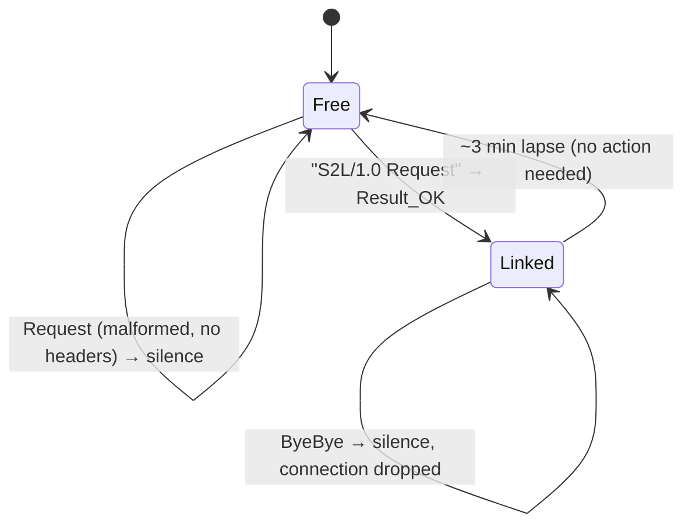

# Camera protocol — hardware findings (ST150F)

Sessions: 2026-10-17 16:48–17:20 WEST, plus a second run the same evening. One Samsung **ST150F**, Wi-Fi AP `AP_SSC_ST150F_0-7D:41:4B`, BSSID `a0:21:95:7d:41:4b`.
Probe host: this Linux laptop, `wlan0`, no root (so no `tcpdump`), curl 8.23.0, Python 3.14.8, ffprobe/ffplay n9.0.2.
Companion document: `camera-protocol-deep-dive.md` — this file is the standalone session report; the deep dive carries the same evidence inline as §12.

Nothing on the camera UI was touched until 17:10; the camera then went through AutoShare → MobileLink → SelectivePush while the probes ran.

---

## 1. Verdict

| # | Claim under test | Outcome |
|---|---|---|
| 1 | Camera IP = DHCP `serverAddress` = SSDP gateway | **confirmed** (`192.168.10x.1`, ARP MAC = AP BSSID) |
| 2 | Mode encoded in the IP's third octet | **confirmed across three modes** — `.103` AutoShare, `.101` MobileLink, `.104` SelectivePush |
| 3 | `HEAD /mode/control` on `:7788` returns `200`/`401`/`503` | **not observed** — closed in AutoShare, both MobileLink sub-modes and Remote Viewfinder; no bytes at all |
| 4 | Camera may request a mode on the phone's `:7789` | **not observed** — 115 s window on `7789–7793`, no inbound |
| 5 | SSDP `M-SEARCH` yields a `LOCATION` with `ST`/`USN`/`SERVER` | **confirmed via `NOTIFY`, not `M-SEARCH`** — every M-SEARCH is ignored; the camera multicasts 5 `NOTIFY` messages (`NT:` rootdevice, MediaServer, ConnectionManager, ContentDirectory, device UUID) with `LOCATION: http://192.168.102.1:7676/smp_2_` |
| 6 | `ContentDirectory` `serviceType`/`controlURL`/`eventSubURL` from the description | **confirmed** — `[Camera]ST150F` MediaServer, control `/smp_4_`, eventSub `/smp_5_`, SCPD `/smp_3_`; description is `401 Unauthorised` without `User-Agent: SEC_RVF_<mac>` + `Access-Method: manual` |
| 7 | DIDL-Lite `Result`, `<res protocolInfo size resolution>`, download headers, stream container/codec, GENA variables | **confirmed except GENA** — 18 images + 3 videos; bare `GET` → `200` with exact `Content-Length`; `livestream.avi` = h264 640x480, container `avi`; `SUBSCRIBE` gets no response |
| 8 | "No proprietary transport is used" | **FALSE** — the camera speaks `S2L/1.0`, verified end-to-end |

Two facts the static analysis does not state: the camera serves an `S2L/1.0` endpoint on TCP `801` naming itself `Shot to Link`, and it exposes a full DLNA MediaServer on **`:7676`** (description `/smp_2_`, control `/smp_4_`) whose discovery relies on multicast `NOTIFY` — it never answers `M-SEARCH`. The file and live-stream server is a separate HTTP server on `:7679`, and it serves only paths that exist.

Both end-to-end proofs were captured: a bare `GET` of a DIDL `<res>` URL returned `200` with real bytes, and `ffprobe` identified the live stream (`h264`, `640x480`, `avi`). See §10.6.

---

## 2. Environment

| Item | Observed |
|---|---|
| Model | ST150F (from the SSID) |
| AP BSSID | `a0:21:95:7d:41:4b` |
| RF | 2.4 GHz, 2437 MHz (ch. 6), DTIM 5, short preamble/slot, `-48…-67 dBm`, 26 Mbit/s TX |
| Host | `192.168.10x.11/24`, MAC `dc:fb:48:00:72:f6` |
| ICMP | 0 % loss, RTT 22–91 ms |
| Firmware / device description | MediaServer `[Camera]ST150F`, model `SP1`, "Samsung Camera DMS", UDN `uuid:875b56a0-183a-10b5-ac32-ce40fc94db84`; camera clock is wrong and jumps (`Date` on `:7676` reads 2013-01-01, on `:7679` 2026-10-15) |

**Wi-Fi power save skews everything.** The same TCP handshake took 0.02 s to 5.5 s depending on idle time, and `S2L` replies arrived 0.00–24 s after the request. Probes with 1.5–3 s timeouts produce false negatives on this hardware; use ≥25 s and keep ICMP flowing (`ping -i 0.3`) during a run.

**Concurrent scans are useless here.** A 400-thread full 65 535-port scan found only `:801`; the same scan at 900 threads found *nothing*, including `:801`. Loaded, the camera simply drops SYNs. Only low-rate, individual probes are trustworthy.

---

## 3. Per-mode fingerprints

The camera keeps **one** AP (same SSID, same BSSID) and re-DHCPs the client onto a different subnet per mode:

| Camera mode | Subnet | Camera-side TCP | SSDP | `:7788` |
|---|---|---|---|---|
| AutoShare ("Shot to Link") | `192.168.103.x` | `801` | silent | dropped |
| MobileLink (sub-mode not yet chosen) | `192.168.101.x` | `7679` | silent | dropped |
| SelectivePush | `192.168.104.x` | `8100` | silent | dropped |

- `.101` MobileLink: `:7679` accepted connections. `/`, `/description.xml`, `/desc.xml`, `/rootDesc.xml`, `/upnp/description.xml` timed out at 10 s with no bytes; `/device_description.xml`, `/dd.xml`, `/index.html` then answered `400 Bad Request`. The server is alive and path-selective, but never returned a listing or a description. `:801` and `:7788` are gone.
- `.104` SelectivePush: `:8100` open, matching the app's camera-side range `8100–8103` (`SelectivePush.java:1333`); the phone-side receiver is `18100` (`SelectivePush.java:70`), exactly mirroring AutoShare's `1801`.
- So the octet tracks the **mode**, not the model, and each mode starts exactly one listener. **None of them start SSDP or `:7788`.**

`[INFERENCE]` In MobileLink the UPnP stack starts only after a sub-mode ("select files from camera" / "select files from smartphone") is chosen — the mode-choice screen exposes `:7679` but no SSDP, which is consistent with an UPnP service that is not yet initialised.

---

## 4. AutoShare / `S2L/1.0` — the verified channel

### 4.1 Handshake

TCP to `192.168.103.1:801`, then this exact block (the app's `AutoShare.SSC_Init`, `AutoShare.java:1170-1215`):

```text
S2L/1.0 Request
Host: SAMSUNG-S2L
Content-Type: text/xml;charset=utf-8
User-Agent: APP-TYPE
Content-Length: 0
HOST-Mac : dc:fb:48:00:72:f6
HOST-Address : 192.168.103.11
HOST-port : 1801
HOST-PNumber : none
Host-Gps : none
Access-Method : manual

```

CRLF line endings, blank line to terminate. `Host-Gps` is `none` when no fix; `HOST-port` is the phone's file receiver (the app's `SERVER_PORT = 1801`, `AutoShare.java:76`).

### 4.2 Replies, verbatim

```text
S2L/1.0 Result_OK\r\nHost: SAMSUNG-S2L\r\nContent-Type: text/xml;charset=utf-8\r\nUser-Agent: Shot to Link\r\n
```

```text
S2L/1.0 Result_Error\r\nHost: SAMSUNG-S2L\r\nContent-Type: text/xml;charset=utf-8\r\nUser-Agent: NONE\r\n
```

The camera announces itself as `Shot to Link` on accept, `NONE` on reject. It sends only `Host`, `Content-Type`, `User-Agent` — the `Content-length`, `Authorization` and `Sub-ErrorCode` headers that the app's own `make_resp` emits (`AutoShare.java:457-459`) are absent, so there is no error code to read.

### 4.3 Session behaviour



| Observation | Detail |
|---|---|
| Single occupancy | First `Request` after a lapse → `Result_OK`; an immediate repeat → `Result_Error` |
| Lockout duration | Polling every ~15 s failed for ~155 s; `Result_OK` returned ~190 s into that round (≈3 min after the last accepted session). One sample |
| `ByeBye` | `S2L/1.0 ByeBye` is **never answered** — the socket goes silent; do not block on it |
| Malformed `Request` | Missing the `HOST-Mac`/`HOST-Address`/`HOST-port`/`Host-Gps`/`Access-Method` block → **no reply at all**, ever |
| `HOST-Mac` validation | **none** — `Result_OK` was also returned for `fc:94:d5:a6:1b:02`, a MAC this host never had |
| Callback | After `Result_OK` the camera does not connect to `<HOST-Address>:<HOST-port>` until a photo exists (nothing in 35 s) |
| Dialect | Not HTTP: request line is `S2L/1.0 <Verb>` with no URI; an HTTP `HEAD`/`GET` sent to `:801` hangs with zero bytes |

---

## 5. Mode negotiation — what the camera actually did

| Direction | Probe | Result |
|---|---|---|
| Phone → camera | `curl -X HEAD http://<cam>:7788/mode/control` with the full `SEC_MODE_*` header set | no TCP handshake, `curl` exit 28 after 8 s; also no handshake with a 30 s timeout |
| Camera → phone | `7789`–`7793` bound, 115 s | no inbound connection |
| Camera → phone | `1801` (AutoShare receiver) bound, 35 s | no inbound connection |

Both mode channels need MobileLink/RVF services the camera never started. A **full re-association** was also tried — Wi-Fi profile down/up, fresh DHCP lease, same BSSID — and changed nothing: `:801` still answered `Result_OK` while `:7788`, `:7679` and SSDP stayed dead. Reconnecting the phone does not start anything; only the camera's own mode selection does.

---

## 6. SSDP

| Probe | Result |
|---|---|
| `M-SEARCH` `ST: ssdp:all` / `...device:MediaServer:1` / `upnp:rootdevice` | silent |
| Destination ports `1900` and `1901`, multicast `239.255.255.250` **and** unicast to the camera | silent |
| Source ports `1900` and `1901` (the app binds the search socket to `SSDP.PORT`) | silent |
| 15 s passive listen on `239.255.255.250:1900` | only foreign devices from the wired LAN (a Twonky server at `192.168.1.1:9000`), nothing from the camera |

No `LOCATION`, therefore no description document, therefore no `ContentDirectory` URN, `controlURL` or `eventSubURL` — and everything downstream (§5, §6, §7 of the deep dive) stays unverified.

---

## 7. Reproduction recipes

Environment check:

```bash
iw dev wlan0 link                       # SSID + BSSID
ip -4 addr show wlan0                   # 192.168.10x.11 => mode = x
ip route show dev wlan0                 # gateway == camera IP
ping -i 0.3 192.168.10x.1               # keep it out of power save while probing
```

AutoShare handshake (Python, 25 s timeouts):

```python
import socket
CAM = "192.168.103.1"
req = ("S2L/1.0 Request\r\nHost: SAMSUNG-S2L\r\nContent-Type: text/xml;charset=utf-8\r\n"
       "User-Agent: APP-TYPE\r\nContent-Length: 0\r\n"
       "HOST-Mac : dc:fb:48:00:72:f6\r\nHOST-Address : 192.168.103.11\r\n"
       "HOST-port : 1801\r\nHOST-PNumber : none\r\nHost-Gps : none\r\n"
       "Access-Method : manual\r\n\r\n")
s = socket.socket(); s.settimeout(25); s.connect((CAM, 801))
s.sendall(req.encode()); print(s.recv(2048))
```

Port fingerprint per mode — one probe at a time, never concurrent:

```python
for p in (801, 7679, 8100, 7788):
    s = socket.socket(); s.settimeout(20)
    print(p, "OPEN" if s.connect_ex((CAM, p)) == 0 else "-")
```

---

## 8. Corrections to apply to the static analysis

1. §1 "No PTP/PTP-IP, RTSP, Bluetooth, or proprietary binary transport is used" — **wrong**. `S2L/1.0` on TCP `801` is a proprietary transport; it is not HTTP, and the app has a third path (`pushservice.autoshare.AutoShare`) that the stack table omitted entirely.
2. §2.5 "For Galaxy-series cameras…" — the octet mapping also governs this non-Galaxy ST150F, and it changes with the mode at runtime (`.103` → `.101` → `.104` observed live).
3. §3.1/§3.2 mode channels — unverified; `:7788` was never open in any observed mode, and no camera-initiated request appeared.
4. New: AutoShare camera reply format and the missing `Sub-ErrorCode`/`Content-length`/`Authorization` headers; the `ByeBye`-is-silent behaviour; the ~3 min single-session lockout.

---

## 9. Open items

Pending:

- **MobileLink pull path.** Both sub-modes were tested *before* the description scheme was known: `:7676` was closed there and no `NOTIFY` was seen, while `:7679` answered `400` to unknown paths. Whether MobileLink exposes the same `/smp_2_` description (possibly with `SEC_DSC_`) on `:7679` is untested.
- **GENA.** `SUBSCRIBE /smp_5_` gets no response, so `RVF_*` variable names and `OperationState` values remain code-derived.
- **`SetStreamQuality`.** Returns `501 Action Failed` while no stream is open; retest with `livestream.avi` being read concurrently.
- **Remote capture.** `Shot`, `ShotWithGPS`, `AFRELEASE`, `ZoomIN/OUT`, `SetFlash`, `SetLED` are declared in the SCPD but not exercised.

The AutoShare evidence in §4, the SelectivePush evidence in §10.3 and the Remote Viewfinder evidence in §10.6 need no repeat.

---

## 10. Second run — mode-by-mode probe

Same camera, same host, later the same day. Camera UI was operated by hand; the camera
moved AutoShare → MobileLink (both sub-options) → SelectivePush while probes ran.

### 10.1 Harness

`tools/camera_probe.py` (stdlib only, three subcommands `ml` / `rvf` / `sp`) is the
reproducible form of everything below. It gates on the subnet octet, prints
`KEY=value` lines, starts a `ping -i 0.3` keepalive, and makes one connection at a time.
It discovers via multicast SSDP `NOTIFY` on `239.255.255.250:1900` (falling back to the
fixed `http://<gw>:7676/smp_2_`), sends `User-Agent: <prefix><wlan mac>` +
`Access-Method: manual` on every UPnP request, parses both CRLF and LF-only responses,
then browses, downloads, calls `GetInfomation` and runs `ffprobe`.

State-gate regression, camera in AutoShare, `ml` requested:

```
STATE_MISMATCH=octet=103
exit=2
```

Harness verification, camera in Remote Viewfinder:

```
LOCATION=http://192.168.102.1:7676/smp_2_
DESC_FETCH=ua=SEC_RVF_dc:fb:48:00:72:f6 status=HTTP/1.1 200 OK
STREAMURL_HIGH=http://192.168.102.1:7679/livestream.avi
codec_name=h264 / width=640 / height=480 / format_name=avi
RVF_PASS=ffprobe_ok
```

### 10.2 Camera menu label → subnet

| Camera UI (Portuguese) | App label (`res/values/strings.xml:85-86`) | Octet | Services |
|---|---|---|---|
| Selecione Arquivos no Smartphone | `MobileLink\nSelect Files from Smartphone` | `.101` | `:7679` only |
| Selecione Arquivos na Câmara | `MobileLink\nSelect Files from Camera` | `.104` | `:8100` only |

SelectivePush is described in the app as "Select and copy captured photos from the camera
to the smartphone" (`strings.xml:253`), which is what the second row does.

### 10.3 SelectivePush on `.104`

`GET /` on `:8100` → `503 Service Unavailable` (`SelectivePush.java:1167` maps 503 to
"Camera Not Accept").

`HEAD /sp/control` with the app's exact header block (`SelectivePush.java:1120`):

```
HEAD /sp/control HTTP/1.1
Host: 192.168.104.1:8100
User-Agent: SEC_SP_dc:fb:48:00:72:f6
Data-Server : 192.168.104.11:18100
Data-Port : 18100
NTS : alive
HOST-PNumber : none
Access-Method : manual
```

→ `HTTP/1.1 200 OK`, `Content-Type: text/xml;charset=utf-8`, `Content-Length: 0`,
`Seerver: Selective Push` (sic, double `e`), in 0.07 s.

The same request hung for 20 s earlier in the session; with the keepalive running it
answered immediately. **The hang was power-save, not header parsing** — an earlier draft
of this report would have recorded the opposite.

A `ServerSocket(18100)` listener received no connection during the HEAD: the camera dials
back only when a push is actually started. Direction is settled by code — the phone holds
`ServerSocket(18100)` and writes `SSC_ERROR_FILE_SAVE_FAIL` on the accepted socket
(`SelectivePush.java:258, 614`), so the camera sends files to the phone. Ports 8100→8103
are tried in order (`SelectivePush.java:1330-1336`).

### 10.4 MobileLink on `.101` — no UPnP endpoint found (inconclusive)

Only `:7679` was open among 7679, 7680, 5000, 7777, 7788, 8009, 801, 8100, 8059, 18100,
1900, 1901, 8080, 5555, 8081.

SSDP was driven at the app's own cadence — `UPNPController.java:201-210` re-issues
`search(ST.ALL_DEVICE)` once per second — to `239.255.255.250:1900` and `:1901`, plus
unicast to the camera, from source ports 1900 and 1901, in 25–30 s windows, with
`ST: ssdp:all`, `upnp:rootdevice`, `urn:samsung.com:device:MediaServer:1`,
`urn:schemas-upnp-org:device:MediaServer:1` and
`urn:schemas-upnp-org:service:ContentDirectory:1`: **0 replies in every window**.

The 1901 destination is not optional guesswork: `PullService` calls `SSDP.setSSDPPort(1901)`
for this old-camera MobileLink case, and CyberGarage's
`SSDPSearchResponseSocketList.post()` sends to `SSDP.PORT`, i.e. 1901, not 1900.

`:7679` returned `400 Bad Request` + `Connection: close` for every request tried:
`GET /`, `GET /description.xml`, `GET /smp000001129121.jpg`, each in the app's own
`GET <path> HTTP/1.0` form with four CRLFs (`HumbleHttpClient.java:34-36`), in minimal
`HTTP/1.0`, and in `HTTP/1.1` with `Host`. The `Date` header jumped between unrelated
times on 2026-10-15 across consecutive requests (01:41, 20:00, 14:18, …), so the camera
clock is unusable. `HEAD`/`PUT`/`POST`/`OPTIONS` on `:7679` timed out in a probe that
ran without the keepalive — inconclusive, and not needed for the verdict.

The URL `http://192.168.101.1:7679/smp000001129121.jpg` (`MobileLink.java:84`) is **demo
data**: `testDBInsert()` inserts ten rows built from that constant into the local database;
it is not a file served by the camera.

Consequence at the time: no `LOCATION`, no description, no `MediaServer`, no
`ContentDirectory`, no DIDL-Lite, no `<res>` URL. This is **inconclusive**, not negative:
`:7676` was closed in that mode, but the correct description path (`/smp_2_`) was unknown
then and was never tried against `:7679` with a `SEC_DSC_` user agent. The RVF run (§10.6)
established the path and the auth scheme; the ML path is the remaining experiment.

### 10.5 Action name

`DeviceController.java:130` defines the Read/Notify action as `GetInfomation` (sic). SOAP
clients must send `SOAPACTION: "<serviceType>#GetInfomation"`; the correctly spelled name
will not match this firmware's SCPD.

### 10.6 Remote Viewfinder — discovery, description, both proofs

The camera had been left in Remote Viewfinder (subnet `.102`). Both proofs were captured there.

**Discovery.** No `M-SEARCH` was ever answered (1 Hz, ports 1900 and 1901, multicast and unicast, `ssdp:all` / `upnp:rootdevice` / vendor URNs). The camera multicasts SSDP `NOTIFY` on `239.255.255.250:1900` when the station associates. Five distinct messages, verbatim:

```
NOTIFY * HTTP/1.1
HOST: 239.255.255.250:1900
CACHE-CONTROL: max-age=1810
LOCATION: http://192.168.102.1:7676/smp_2_
NT: uuid:875b56a0-183a-10b5-ac32-ce40fc94db84
NTS: ssdp:alive
SERVER: SHP, UPnP/1.0, Samsung UPnP SDK/1.0
USN: uuid:875b56a0-183a-10b5-ac32-ce40fc94db84
```

The other four carry the same `LOCATION`/`SERVER` with `NT:` = `urn:schemas-upnp-org:device:MediaServer:1`, `urn:schemas-upnp-org:service:ConnectionManager:1`, `urn:schemas-upnp-org:service:ContentDirectory:1`, `upnp:rootdevice`, and the matching `USN` suffixes.

**Description.** `:7676` is the UPnP endpoint; `:7679` is the file/stream server. `/smp_2_` is auth-gated by the same header pair the app attaches in `Parser.java:27-30`:

| `User-Agent` | Result |
|---|---|
| `SEC_RVF_<wlan mac>` | `200 OK`, 1503 bytes |
| `SEC_DSC_<wlan mac>` | `401 Unauthorised` |
| `SEC_RVF_ML_<wlan mac>` | `401 Unauthorised` |

Values: `deviceType urn:schemas-upnp-org:device:MediaServer:1`, `friendlyName [Camera]ST150F`, `modelName SP1`, `modelDescription Samsung Camera DMS`, `serialNumber 20081113 Folderview`, `UDN uuid:875b56a0-183a-10b5-ac32-ce40fc94db84`, `X_ProductCap smi,getMediaInfo.sec,getCaptionInfo.sec`, `SERVER: SHP, UPnP/1.0, Samsung UPnP SDK/1.0`. ContentDirectory: control `/smp_4_`, eventSub `/smp_5_`, SCPD `/smp_3_`. ConnectionManager: `/smp_7_`, `/smp_8_`, `/smp_6_`.

**SCPD** (`/smp_3_`, 9441 bytes) declares `GetSystemUpdateID`, `GetSearchCapabilities`, `GetSortCapabilities`, `Browse`, `GetIP`, `GetInfomation` (sic), `SetResolution`, `ZoomIN`, `ZoomOUT`, `MULTIAF`, `AF…`, `AFRELEASE`, `ReleaseSelfTimer`, `Shot`, `ShotWithGPS`, `SetLED`, `SetFlash`, `SetZoom`, `GetZoom`, `SetStreamQuality`. `GetInfomation` takes **no input arguments**.

**Browse.** `ObjectID=0` → `NumberReturned=2`, `TotalMatches=2`: container `1` "Image" and container `3` "Video". `ObjectID=1` → 18 photo items; `ObjectID=3` → 3 video items. Verbatim samples:

```xml
<res size="5800597" resolution="4608x3456" protocolInfo="http-get:*:image/jpeg:DLNA.ORG_PN=JPEG_LRG;DLNA.ORG_OP=01;DLNA.ORG_FLAGS=00D00000000000000000000000000000">http://192.168.102.1:7679/smp000058928257.jpg</res>
<res size="8239" resolution="160x120" protocolInfo="http-get:*:image/jpeg:DLNA.ORG_PN=JPEG_TN;DLNA.ORG_OP=01;DLNA.ORG_CI=1;DLNA.ORG_FLAGS=00D00000000000000000000000000000">http://192.168.102.1:7679/smpthumb000059928259.jpg</res>
<res size="109444" resolution="480x640" protocolInfo="http-get:*:image/jpeg:DLNA.ORG_PN=JPEG_SM;DLNA.ORG_OP=01;DLNA.ORG_CI=1;DLNA.ORG_FLAGS=00D00000000000000000000000000000">http://192.168.102.1:7679/smpscreen000060928259.jpg</res>
<res size="12403450" bitrate="302516213" duration="0:00:09" resolution="1280x720" protocolInfo="http-get:*:video/mp4:DLNA.ORG_OP=01">http://192.168.102.1:7679/smp000005927769.mp4</res>
```

**Proof 1 — bare GET.** No headers at all:

| Resource | Status | Type | Bytes | `file` |
|---|---|---|---|---|
| thumb | `200` | `image/jpeg` | 8239 | JPEG 160x120 |
| screen | `200` | `image/jpeg` | 109444 | JPEG 640x480 |
| original | `200` | `image/jpeg` | 5800597 | JPEG 4608x3456, EXIF `model=ST150F`, `FW Ver 1310151` |
| video | `200` | `video/mp4` | 12403450 | ISO Media, MP4 v2 |

A raw socket `GET /smpthumb000059928259.jpg HTTP/1.0` returned `HTTP/1.0 200 OK`, `Content-Type: image/jpeg`, `Content-Length: 8239`, `transferMode.dlna.org: Interactive`. File GETs require no auth; `:7679` returns `400 Bad Request` only for non-existent paths.

**`GetInfomation`** with no arguments:

```xml
<StreamUrl><QualityHighUrl>http://192.168.102.1:7679/livestream.avi</QualityHighUrl><QualityLowUrl>http://192.168.102.1:7679/qvga_livestream.avi</QualityLowUrl></StreamUrl>
<StreamQuality><Quality><Option>high</Option><Option>low</Option></Quality><Default>high</Default></StreamQuality>
```

`GETINFORMATIONRESULT` also carried `Resolutions` 4608x2592 and 1920x1080, `Flash` off/auto (default auto), `ZoomInfo` default 0 / max 10, `AVAILSHOTS 4492`, `ROTATION 0`.

**Proof 2 — ffprobe.**

```
codec_name=h264
codec_type=video
width=640
height=480
format_name=avi
```

Exit 0, no forced container. `-f avi` and `-f mjpeg` both time out (rc 124), so the demuxer must be auto-detected.

**Not observed.** `SUBSCRIBE /smp_5_` returns nothing (25 s timeout); no `NOTIFY` events, so no `RVF_*` variables. `SetStreamQuality <Quality>low</Quality>` returns SOAP fault `501 Action Failed`; `GetInfomation` still reports the same URLs. The camera's `Date` header is unusable: `:7676` said 2013-01-01, `:7679` said 2026-10-15, both jumping between requests.

**Operational note.** After an aborted stream read (`ffprobe`/`ffplay` killed by `timeout`), `:7679` stops answering for roughly 20–60 s — the camera's file server is single-session and waits for the stale stream to be reaped. `:7676` keeps answering throughout, and the file server recovers by itself (verified: thumbnail `200`, 8239 bytes, after a 20 s wait). Exiting and re-entering the camera mode restarts it immediately; a power cycle is the fallback if the camera UI is also stuck. No persistent state is changed on the camera by these probes.

**Harness note.** `:7676` replies with LF-only header line endings while `:7679` uses CRLF; a client that splits on `\r\n\r\n` only will treat the whole response as headers. `tools/camera_probe.py` handles both.

### 10.7 Camera freeze and recovery

At the end of the RVF run the camera hung. Sequence: `ffprobe` and `ffplay` were killed by
`timeout` while reading `livestream.avi`; `:7679` then stopped answering (curl timeout,
0 bytes) while `ping` and `:7676` stayed healthy; the viewfinder went black, the lens
stayed extended, and the power button did not respond.

- Disconnecting the station (`nmcli connection down`) did not clear it.
- `:7679` recovered by itself about 40 s later (thumbnail `200`, 8239 bytes), but the
  camera UI remained hung and could not be powered off.
- Recovery requires cutting power: hold the power button 10–15 s; if it does not respond,
  open the battery door and remove the battery for ~10 s. Do not push the extended lens in;
  it retracts on the next boot.

Cause: `:7679` is a single-session server and the camera's UI thread blocks on the stale
stream. A stream probe must be allowed to terminate on its own or be reaped; killing the
client mid-read is what wedges it. The `nmcli` down/up cycles used for NOTIFY discovery
cause brief AP drops but are not implicated in the freeze.

---

## 11. Method and tooling

### 11.1 How the investigation actually proceeded

| Step | Action | What it established |
|---|---|---|
| 1 | Static read of the decompiled app (`PullService`, `UPNPController`, `DeviceController`, CyberGarage, `AutoShare`, `SelectivePush`) | the claims under test: SSDP ports/prefixes, action names, URL shapes, auth headers |
| 2 | First camera session, AutoShare only | `S2L/1.0` on `:801` verified end-to-end; `:7788` closed; no SSDP; mode→octet map (`.103`) |
| 3 | Second session: built the probe harness, added a state gate | octet gate works (`STATE_MISMATCH=octet=103`, exit 2) |
| 4 | Cycled the camera UI: MobileLink "Smartphone" → `.101`, "Câmara" → `.104`, Remote Viewfinder → `.102` | the octet is the mode, chosen per sub-option |
| 5 | SelectivePush probe: `HEAD /sp/control` | `200 OK`, `Seerver: Selective Push`; direction camera→phone confirmed in code |
| 6 | MobileLink: candidate ports, M-SEARCH at 1 Hz on 1900/1901, path fuzz on `:7679` | only `:7679` open, `400` for every path, no M-SEARCH reply |
| 7 | RVF: port scan found `:7676` | a second HTTP server, `404` for unknown paths, `405` for non-GET/HEAD/POST |
| 8 | Bound UDP 1900 and listened instead of probing | **breakthrough**: the camera multicasts SSDP `NOTIFY` with `LOCATION: http://192.168.102.1:7676/smp_2_` |
| 9 | Auth matrix on `/smp_2_` | `SEC_RVF_<mac>` + `Access-Method: manual` → `200`; `SEC_DSC_` → `401` |
| 10 | Description → SCPD → `Browse` → res URLs | real DIDL, 18 images, 3 videos, control `/smp_4_`, SCPD `/smp_3_` |
| 11 | Bare `GET` of `<res>` URLs | **proof 1**: `200`, `image/jpeg`, exact `Content-Length` |
| 12 | `GetInfomation` → `StreamUrl` → `ffprobe` | **proof 2**: `h264`, `640x480`, `avi` |
| 13 | `SUBSCRIBE`, `SetStreamQuality`, aborted stream reads | GENA does not answer; `SetStreamQuality` 501; aborted reads wedge `:7679` and can freeze the camera |

### 11.2 Persistent script

`tools/camera_probe.py` — stdlib only, ~35 KB, three subcommands.

```bash
python3 tools/camera_probe.py rvf [--wait 120] [--ssdp-wait 45] [--no-reconnect]
python3 tools/camera_probe.py ml  [--expect-octet 101,104]
python3 tools/camera_probe.py sp
```

Exit codes: `0` proof captured, `2` wrong camera state, `3` blocked, `4` partial.

| Function | Role |
|---|---|
| `ensure_link()` | waits for the expected subnet octet; recycles the saved NetworkManager profile only when the host is **not** associated with the camera AP |
| `Keepalive` | `ping -i 0.3` in a thread; without it SYN-ACKs lag 0.02–5.5 s and every short timeout is a false negative |
| `notify_listen()` | binds UDP 1900, rejoins the multicast group as the lease changes, sends M-SEARCH at 1 Hz, prints every `NOTIFY` verbatim, returns `LOCATION` |
| `discover()` | NOTIFY first; if silent, cycles the link **while listening**; final fallback is the fixed `http://<gw>:7676/smp_2_` |
| `force_assoc()` | `nmcli connection down/up` once — causes a brief AP drop, used only when NOTIFY is missed |
| `curl_http()` | `curl -i` wrapper that splits headers from body on **either** `\r\n\r\n` or `\n\n` (`:7676` uses LF-only) |
| `get_description()` | tries `<prefix><mac>` user agents in order and requires `<root` in the body |
| `parse_description()` | finds the first `MediaServer` device and its `ContentDirectory` service (same substring match as `UPNPController.java:150-175`) |
| `soap_call()` | POST with `Content-Type`/`SOAPACTION` plus auth headers |
| `browse_all()` | pages `ObjectID=0`, then descends containers depth-first, two levels |
| `download_proof()` | bare `curl -o` with no headers, then `file -b` |
| `get_information()` | tries `GetInfomation` (firmware spelling) then `GetInformation`, with no input arguments |
| `parse_stream_urls()` | extracts `StreamUrl`/`StreamQuality` children and `GETIPRESULT` |
| `run_ml` / `run_rvf` / `run_sp` | mode flows; print `ML_PASS` / `RVF_PASS` / `SP_CONTROL` or a `*_BLOCKED=reason=…` line |

Deliberate omissions: no concurrent port scans, no `SUBSCRIBE` on the proof path (it wedges the camera's single connection handler), no forced `-f` for `ffprobe`/`ffplay`.

### 11.3 Throwaway probes

These were inline `python3 - <<'EOF'` heredocs, not saved; the harness supersedes them. Listed so the reasoning is reproducible.

| Probe | Purpose | Outcome |
|---|---|---|
| State-gate/port check | confirm the octet gate and which ports are open | `STATE_MISMATCH=octet=103`; later only `:7679` (ML), `:8100` (SP), `:7676`+`:7679` (RVF) |
| M-SEARCH sweep | send 5 variants × 2 ports × multicast+unicast | 0 replies, every time |
| 1 Hz M-SEARCH | match `UPNPController.java:201-210` exactly | still 0 replies |
| **NOTIFY listener** | bind UDP 1900, join `239.255.255.250`, print datagrams | **found `LOCATION`** — the only discovery path that works |
| Auth matrix | GET `/smp_2_` with `SEC_RVF_` / `SEC_DSC_` / `SEC_RVF_ML_` | `200` / `401` / `401` |
| Browse (curl + `html.unescape`) | read DIDL from `/smp_4_` | 2 containers, 18 images, 3 videos |
| Bare GET | `curl -o` with no headers, then `file` | `200`, 8239 B, real JPEG |
| `GetInfomation` + `ffprobe` | fetch stream URLs and probe them | `livestream.avi`, h264 640x480, `avi` |
| SUBSCRIBE + local HTTP server | capture GENA events | no response; the unanswered request wedges the camera |
| Parser self-test | feed fixture XML to `parse_description`/`didl_entries`/`parse_stream_urls` | all pass (run offline, no camera) |

Two mistakes are worth keeping in the record:

- **Concurrent scanning kills the link.** A 900-thread port scan made the camera drop every connection, including a port that was open. Only sequential, single probes are trustworthy.
- **A probe without a delay flooded the camera.** One `sendto` loop ran without `sleep`, emitting ~680k datagrams in 30 s, and its own multicast was looped back and mistaken for a reply. Correct form: 1 packet per second, `IP_MULTICAST_LOOP=0`, and ignore datagrams whose source is the host's own address.

### 11.4 Host commands used

`ip -4 addr`, `ip route`, `iw dev wlan0 link`, `nmcli connection up/down <uuid>`, `ping -i 0.3`, `curl -sS --max-time N -i` (and `-o` / `-w '%{http_code} %{content_type} %{size_download}'`), `timeout N ffprobe …`, `timeout N ffplay …`, `file -b`, `sed`/`grep` for source anchors.

No root: no `tcpdump`, no raw sockets, no packet capture. Everything above is ordinary UDP/TCP sockets plus `curl`, which is why the NOTIFY listener was the decisive move — it does not need privileges.

### 11.5 Artifacts

Ephemeral, in `/tmp` (may not survive a reboot): `scpd.xml` (9441 B, `/smp_3_`), `browse.xml` (the SOAP request body), `harness2.log` / `harness_rvf.log` / `ml_proof_run.log` / `rvf_proof_run.log` / `sp_proof_run.log`, `proof_thumb.jpg`, `proof_screen.jpg`, `proof_orig.jpg`, `proof_video.mp4`.

Regenerate any of them with the harness; the downloads in particular are reproducible byte-for-byte while the card contents are unchanged.

### 11.6 Cold-start runbook

1. Charge the camera and power it on.
2. Camera menu → the mode to test. Expect the subnet octet to match: `.101` MobileLink-Smartphone, `.102` Remote Viewfinder, `.103` AutoShare, `.104` MobileLink-Camera/SelectivePush.
3. `python3 tools/camera_probe.py rvf` (or `ml`, `sp`).
4. Read the last line: `RVF_PASS=ffprobe_ok`, `ML_PASS=download_200`, `SP_CONTROL=HTTP/1.1 200 OK`, or `*_BLOCKED=reason=…`.
5. If the camera stops answering afterwards, leave it idle for a minute; if the UI is also hung, hold power 10–15 s, then pull the battery (§10.7).
